Schedulers control **when to train**, **how much history to use**, and **when to score new observations**. Define a named scheduler and reference its alias from a model. A model can use more than one scheduler. Models with different cadences can reference different aliases.

For continuous detection, start with a `periodic` scheduler. This snippet belongs alongside your [reader](https://docs.victoriametrics.com/anomaly-detection/components/reader/) and [writer](https://docs.victoriametrics.com/anomaly-detection/components/writer/) configuration:

```yaml
schedulers:
  production:
    class: periodic
    fit_window: 14d  # History used by each fit.
    fit_every: 1000w # Effectively fit once; update online during inference.
    infer_every: 1m  # Score new observations every minute.

models:
  baseline:
    class: zscore_online
    schedulers: [production]

# other config sections ...
```

The scheduler alias connects these two sections. See [model scheduler assignment](https://docs.victoriametrics.com/anomaly-detection/components/models/#schedulers) for using multiple schedulers.

> [!WARNING]
> Set `fit_every` explicitly. If omitted, it inherits `infer_every`, which can retrain the full fit window on every inference run. For a scheduler attached only to online models, use a long interval such as `1000w` to avoid periodic resets of learned state. If offline models share the scheduler, choose the refit cadence they need or assign them a separate scheduler.

With `fit_every: 1000w`, the next scheduled refit is 1,000 weeks after the initial fit. The initial fit still reads `fit_window`. Subsequent inference updates the online model. Enable [state restoration](https://docs.victoriametrics.com/anomaly-detection/components/settings/#state-restoration) to reuse compatible learned state across restarts.

## Parameters

Each entry under `schedulers` selects a `class`. The remaining parameters depend on that class:

| Class | Use it for | Execution |
| --- | --- | --- |
| [`periodic`](#periodic-scheduler) (default) | Continuous detection | Repeated fitting and inference on new observations. |
| [`oneoff`](#oneoff-scheduler) | One historical run or backfill | Fit and infer once, then exit. |
| [`backtesting`](#backtesting-scheduler) | Evaluate a configuration on historical data | Replay fitting and inference over a fixed range, then exit. |

For continuous detection, the main controls are `fit_window` (training-history length), `fit_every` (refit cadence), and `infer_every` (scoring cadence). Their requirements and optional settings are listed below. Oneoff and backtesting instead require explicit historical time ranges.

## Periodic scheduler

Use `periodic` for continuous detection, as in the example above. `fit_window` sets the history length. `fit_every` sets the refit cadence. Keep `infer_every` at least as large as the reader's query step. Choose the history and refit cadence for your model and alerting needs.

### Parameters

Specify durations with a unit suffix: `50s`, `4m`, `3h`, `2d` or `1w`.

<table class="params">
    <thead>
        <tr>
            <th>Parameter</th>
            <th>Type</th>
            <th>Example</th>
            <th><span style="white-space: nowrap;">Description</span></th>  
        </tr>
    </thead>
    <tbody>
        <tr>
            <td>

<span style="white-space: nowrap;">`fit_window`</span>
            </td>
            <td>str</td>
            <td>

`14d`
            </td>
            <td>Training-history length. Must be at least 1 second.</td>
        </tr>
        <tr>
            <td>

<span style="white-space: nowrap;">`infer_every`</span>
            </td>
            <td>str</td>
            <td>

`1m`
            </td>
            <td>How often to score new observations and write anomaly scores. Must be at least 1 second.</td>
        </tr>
        <tr>
            <td>

<span style="white-space: nowrap;">`fit_every`</span>
            </td>
            <td>str, Optional</td>
            <td>

`1h`
            </td>
            <td>

How often to completely retrain the models. If not set, value of `infer_every` is used and retrain happens on every inference run.
            </td>
        </tr>
        <tr>
            <td>

<span style="white-space: nowrap;">`start_from`{}</span>
            </td>
            <td>str, <span style="white-space: nowrap;">Optional</span></td>
            <td>

<span style="white-space: nowrap;">`2024-11-26T01:00:00Z`</span>, `01:00`
            </td>
            <td>

Specifies when to initiate the first `fit_every` call. Accepts either an ISO 8601 datetime or a time in HH:MM format. If the specified time is in the past, the next suitable time is calculated based on the `fit_every` interval. For the HH:MM format, if the time is in the past, it will be scheduled for the same time on the following day, respecting the `tz` argument if provided. By default, the timezone defaults to `UTC`.
            </td>
        </tr>
        <tr>
            <td>

<span style="white-space: nowrap;">`tz`{}</span>
            </td>
            <td>str, <span style="white-space: nowrap;">Optional</span></td>
            <td>

`America/New_York`
            </td>
            <td>

Defines the scheduler timezone, including `start_from` values without an explicit offset. ISO values with an explicit offset retain their instant. Defaults to `UTC`. {} Periodic interval triggers explicitly use this timezone instead of the container local timezone.
            </td>
        </tr>
        <tr>
            <td>

<span style="white-space: nowrap;">`scatter_infer_jobs`{}</span>
            </td>
            <td>bool, <span style="white-space: nowrap;">Optional</span></td>
            <td>

`true` or `false`
            </td>
            <td>

If `true`, distribute infer jobs and their dependent data-fetch jobs evenly across the infer interval. This reduces synchronized read and inference bursts for high-scale configurations. Defaults to `false`. Useful when `settings.n_workers > 1`, `reader.queries` cardinality is high, and `scheduler.infer_every` is small.
            </td>
        </tr>
    </tbody>
</table>

> [!NOTE]
>  With separate periodic fit and inference jobs, the scheduler tracks the inference fetch boundary and recovers scheduling jitter or reported fetch failures within a total window of at most two `infer_every` intervals. Startup and normal ticks request one interval. Already-scored timestamps are filtered before inference. This scheduler-owned recovery is independent of reader `query_from_last_seen_timestamp` and `query_last_seen_max_lookback`. Longer gaps need reader recovery.
>
> Recovery covers a bounded fetch window. Model or write failures may still leave gaps that require a separate replay. Combined fit/infer scheduling retains its previous behavior and does not gain this cursor recovery. Reader offsets and grid alignment still apply to the requested window.

For example, let `infer_every: 1m`, the last successful fetch boundary be 12:01, and the 12:02 fetch fail. At the 12:03 tick, scheduler recovery requests two minutes instead of one. With `offset: -1m`, the reader shifts that requested range one minute into the past:

```mermaid
---
config:
  gantt:
    useMaxWidth: true
    useWidth: 640
    leftPadding: 135
    rightPadding: 20
---
gantt
    dateFormat HH:mm
    axisFormat %H:%M
    tickInterval 1minute
    section At the 12:03 tick
    Normal                    :normal, 12:02, 1m
    Recovery                  :recovery, 12:01, 2m
    Offset -1m                :shifted, 12:00, 2m
```



This illustrates requested time ranges before endpoint-specific grid alignment, with reader last-seen recovery disabled. The scheduler cursor tracks fetched data. Check model and writer metrics separately to confirm processing succeeded. Optional reader recovery can extend the range separately. See [VM reader recovery](https://docs.victoriametrics.com/anomaly-detection/components/reader/#vm-last-seen-recovery), [VLogs reader recovery](https://docs.victoriametrics.com/anomaly-detection/components/reader/#vlogs-last-seen-recovery), and [offsets](https://docs.victoriametrics.com/anomaly-detection/faq/#using-offsets).

> [!NOTE]
>  For exact-capable [online models](https://docs.victoriametrics.com/anomaly-detection/components/models/#online-models), `infer_every` is also the causal model-update cadence. If a delayed periodic job fetches several observations at once, they are processed on the same chronological grid used by exact backtesting rather than as one behaviorally different batch.

> [!NOTE]
>  If a periodic scheduler worker exits unexpectedly, the service attempts bounded restarts with exponential backoff instead of shutting down unrelated schedulers. Monitor [`vmanomaly_scheduler_alive`](https://docs.victoriametrics.com/anomaly-detection/components/monitoring/#startup-metrics) and `vmanomaly_scheduler_restarts_total` to alert on persistent failures.

> [!WARNING]
> With `start_from`, enable [`settings.restore_state`](https://docs.victoriametrics.com/anomaly-detection/components/settings/#state-restoration) to resume the schedule after a restart. Without restored state, the service can wait until the next configured start time. A restart after a daily `20:00` start can delay inference until `20:00` the next day.

<div class="collapse-group mb-3">

{}

### Periodic scheduler config example

```yaml
schedulers:
  periodic_scheduler_alias:
    class: "periodic"
    # (or class: "scheduler.periodic.PeriodicScheduler" for versions before v1.13.0, without class alias support)
    fit_window: "14d" 
    infer_every: "1m" 
    scatter_infer_jobs: true  # Distribute infer jobs evenly across the infer interval to reduce synchronized bursts.
    fit_every: "1000w"  # For a scheduler attached only to online models.
    start_from: "20:00"  # If launched before 20:00 (local Kyiv time), the first run starts today at 20:00. Otherwise, it starts tomorrow at 20:00.
    tz: "Europe/Kyiv"  # Defaults to 'UTC' if not specified.
```

This online-only example fits on the latest 14 days at the next `20:00` in Kyiv, then scores new observations and updates the model every minute. The `1000w` refit interval makes this effectively a bootstrap fit. Any later refit still uses a 14-day history window.

{}

</div>

## Oneoff scheduler

Fit once on a fixed historical range, score a separate range, then exit. Use this for a single backfill or a quick model check. Use [Backtesting](#backtesting-scheduler) to replay repeated fitting and inference.

### ISO format scheduler config example
```yaml
schedulers:
  oneoff_scheduler_alias:
    class: "oneoff"
    # (or class: "scheduler.oneoff.OneoffScheduler" until v1.13.0 with class alias support)
    fit_start_iso: "2022-04-01T00:00:00Z"
    fit_end_iso: "2022-04-10T00:00:00Z"
    infer_start_iso: "2022-04-11T00:00:00Z"
    infer_end_iso: "2022-04-14T00:00:00Z"

# other config sections ...
```

Attach this scheduler to a model with `schedulers: [oneoff_scheduler_alias]`. The example fits on April 1 - 10 and scores April 11 - 14, 2022. Replace both ranges with times covered by your datasource.

### Parameters
For Oneoff scheduler timeframes can be defined in Unix time in seconds or ISO 8601 string format. 
ISO format supported time zone offset formats are:
* Z (UTC)
* ±HH:MM
* ±HHMM
* ±HH

If a time zone is omitted, a timezone-naive datetime is used.

### Defining fitting timeframe

Choose ISO timestamps or Unix seconds for each boundary:

| Parameter | Type | Meaning |
| --- | --- | --- |
| `fit_start_iso` / `fit_start_s` | string / number | Start of training history. |
| `fit_end_iso` / `fit_end_s` | string / number | End of training history. Must be later than the start. |

### Defining inference timeframe

| Parameter | Type | Meaning |
| --- | --- | --- |
| `infer_start_iso` / `infer_start_s` | string / number | Start of the range to score. |
| `infer_end_iso` / `infer_end_s` | string / number | End of the range to score. Must be later than the start. |

> [!WARNING]
> Oneoff runs do not save or restore scheduler state. Enabling [state restoration](https://docs.victoriametrics.com/anomaly-detection/components/settings/#state-restoration) logs a warning for this scheduler. Use [Periodic](#periodic-scheduler) for recurring, resumable execution.

<div class="collapse-group mb-3">

{}

### UNIX time format scheduler config example
```yaml
schedulers:
  oneoff_scheduler_alias:
    class: "oneoff"
    # (or class: "scheduler.oneoff.OneoffScheduler" until v1.13.0 with class alias support)
    fit_start_s: 1648771200
    fit_end_s: 1649548800
    infer_start_s: 1649635200
    infer_end_s: 1649894400
```

{}

</div>

## Backtesting scheduler

Replay a configuration over historical data with repeated fitting and inference, then exit. Use `inference_only: true` so the requested range is the range to score. Training history is read before it. This mode is available {} and defaults to `false` for backward compatibility.

```yaml
schedulers:
  historical:
    class: backtesting
    inference_only: true
    from_iso: "2025-05-08T00:00:00Z"
    to_iso: "2025-05-09T00:00:00Z"
    fit_window: 7d
    fit_every: 12h
    exact: true
    infer_every: 1h
    n_jobs: 1
```

The finite `fit_every` values in the backtesting examples deliberately demonstrate repeated refitting. To evaluate an online-only deployment that fits once, match its long `fit_every` (for example, `1000w`) and use `inference_only: true` with `exact: true`.

Attach it with `schedulers: [historical]`. Provide at least seven days of training history before the start in this example. `exact` processes online updates chronologically. See the version requirements in [Configuration Parameters](#configuration-parameters).

### Parameters
As for [Oneoff scheduler](#oneoff-scheduler), timeframes can be defined in Unix time in seconds or ISO 8601 string format. 
ISO format supported time zone offset formats are:
* Z (UTC)
* ±HH:MM
* ±HHMM
* ±HH

If a time zone is omitted, a timezone-naive datetime is used.

### Parallelization

| Parameter | Type | Default | Meaning |
| --- | --- | --- | --- |
| `n_jobs` | integer | `1` | Concurrent backtesting jobs. `1` runs sequentially.  |

Increase `n_jobs` only when CPU and memory allow it. Each concurrent job adds resource demand. More jobs do not guarantee proportional speedup.

### Inference only mode

In **Inference only** mode {}, the scheduler splits your overall time window into non-overlapping inference segments and automatically derives the preceding training segments:

1. **Inference Window**  
   - Defined by your `from`/`to` (or `from_iso`/`to_iso`) parameters.
   - Each inference segment spans the configured `fit_every` duration.
2. **Training Window**  
   - Automatically set to the configured `fit_window` immediately preceding each inference segment.
   - Ensures each model is trained on the most recent `fit_window` of data before inferring, see [example](#example) section for the details

For a compact example, use `fit_window: 2h`, `fit_every: 1h`, and an inference range of 10:30 - 12:00 on the same day. The first inference segment is clipped to 30 minutes. Each segment still has two hours of preceding training data:

```mermaid
---
config:
  gantt:
    useMaxWidth: true
    useWidth: 640
    leftPadding: 135
    rightPadding: 20
---
gantt
    dateFormat HH:mm
    axisFormat %H:%M
    tickInterval 30minute
    section First model
    Training              :a1, 08:30, 2h
    Inference (partial)   :a2, 10:30, 30m
    section Second model
    Training              :b1, 09:00, 2h
    Inference             :b2, 11:00, 1h
```



The training windows share part of their history. The inference segments cover consecutive, non-overlapping parts of the requested range. With `exact: true` and `infer_every: 15m`, each inference segment is processed in chronological 15-minute steps. The longer [worked example](#example) below uses the same rules.

#### Configuration Parameters
- `inference_only: true`: Enables of such inference-only behavior.
- `from`, `to` (or `from_iso`, `to_iso`): Overall inference-only timeframe.
- `fit_window`: Duration of historical data used for each training run (e.g. `P7D`, `PT1H`).
- `fit_every`: Interval between consecutive training/inference cycles.
- {} `exact`: If set to `true`, BacktestingScheduler will execute inference for online models in small chronological batches equal to `infer_every` to mimic the production scheduler. (default: `false`)
- {} `infer_every`: Optional inference grid and, in exact mode, model-call cadence between two fits. {} In `inference_only` mode, an omitted value is derived from the effective query step or reader sampling period and capped by `fit_every`. It falls back to `fit_every` only when neither reader value is available.
- `n_jobs`: Number of parallel jobs for backtesting (default: `1`).

> [!NOTE]
>  The [UI](https://docs.victoriametrics.com/anomaly-detection/ui/) uses inference-only backtesting to evaluate configurations on historical data before deployment.

> [!WARNING]
> Backtesting runs do not save or restore scheduler state. Enabling [state restoration](https://docs.victoriametrics.com/anomaly-detection/components/settings/#state-restoration) logs a warning for this scheduler. Use [Periodic](#periodic-scheduler) for recurring, resumable execution.

<div class="collapse-group mb-3">

{}

#### Example

The config

```yaml
# other config sections ...
schedulers:
  backtesting_inference_only:       # scheduler alias
    class: "backtesting"
    fit_window: "P7D"               # train on the 7-day window preceding each inference
    fit_every: "PT12H"              # inference interval of 12 hours
    exact: true                    # enable exact mode for online models, doesn't affect offline models
    infer_every: "PT1H"            # inference cadence for exact mode, only used if exact: true
    inference_only: true            # use [from, to] to construct inference windows only
    from_iso: "2025-05-08T03:00:00Z"
    to_iso:   "2025-05-09T00:00:00Z"
    n_jobs: 2                       # number of parallel jobs
```

will result in 2 intervals:

- Complete inference interval (12h): `2025-05-08T12:00:00Z` - `2025-05-09T00:00:00Z`
<br>Training window (7d): `2025-05-01T12:00:00Z` - `2025-05-08T12:00:00Z`

- Partial inference interval (9h): `2025-05-08T03:00:00Z` - `2025-05-08T12:00:00Z` 
<br>(start is "clipped" by `from_iso` so it's less than `fit_every`)
<br>Training window (7d): `2025-05-01T03:00:00Z` - `2025-05-08T03:00:00Z`

Where models, fit on training window, will be used to calculate [anomaly scores](https://docs.victoriametrics.com/anomaly-detection/faq/#what-is-anomaly-score) on respective inference windows.

{}

</div>

<div class="collapse-group mb-3">

{}

### Defining overall timeframe

> This legacy mode is retained for backward compatibility and is less straightforward. Use it only if you cannot upgrade `vmanomaly` to [v1.22.1](https://docs.victoriametrics.com/anomaly-detection/changelog/#v1221) or later.

This timeframe will be used for slicing on intervals `(fit_window, infer_window == fit_every)`, starting from the *latest available* time point, which is `to_*` and going back, until no full `fit_window + infer_window` interval exists within the provided timeframe.
<table class="params">
    <thead>
        <tr>
            <th>

<span style="white-space: nowrap;">Format</span>
            </th>
            <th>

<span style="white-space: nowrap;">Parameter</span>
            </th>
            <th>

<span style="white-space: nowrap;">Type</span>
            </th>
            <th>

<span style="white-space: nowrap;">Example</span>
            </th>
            <th><span style="white-space: nowrap;">Description</span></th>  
        </tr>
    </thead>
    <tbody>
        <tr>
            <td><span style="white-space: nowrap;">ISO 8601</span></td>
            <td>

<span style="white-space: nowrap;">`from_iso`</span>
            </td>
            <td><span style="white-space: nowrap;">str</span></td>
            <td>

`"2022-04-01T00:00:00Z", "2022-04-01T00:00:00+01:00", "2022-04-01T00:00:00+0100", "2022-04-01T00:00:00+01"`
            </td>
            <td rowspan=2>Start datetime to use for backtesting.</td>
        </tr>
        <tr>
            <td>UNIX time</td>
            <td>

<span style="white-space: nowrap;">`from_s`</span>
            </td>
            <td>float</td>
            <td>1648771200</td>
        </tr>
        <tr>
            <td>ISO 8601</td>
            <td>

<span style="white-space: nowrap;">`to_iso`</span>
            </td>
            <td>str</td>
            <td>

`"2022-04-10T00:00:00Z", "2022-04-10T00:00:00+01:00", "2022-04-10T00:00:00+0100", "2022-04-10T00:00:00+01"`
            </td>
            <td rowspan=2>End datetime to use for backtesting. Must be greater than 

`from_start_*`
            </td>
        </tr>
        <tr>
            <td>UNIX time</td>
            <td>

<span style="white-space: nowrap;">`to_s`</span>
            </td>
            <td>float</td>
            <td>1649548800</td>
        </tr>
    </tbody>
</table>

### Defining training timeframe
The same *explicit* logic as in [Periodic scheduler](#periodic-scheduler)
<table class="params">
    <thead>
        <tr>
            <th><span style="white-space: nowrap;">Format</span></th>
            <th>Parameter</th>
            <th><span style="white-space: nowrap;">Type</span></th>
            <th><span style="white-space: nowrap;">Example</span></th>
            <th><span style="white-space: nowrap;">Description</span></th>  
        </tr>
    </thead>
    <tbody>
        <tr>
            <td>ISO 8601</td>
            <td rowspan=2>

<span style="white-space: nowrap;">`fit_window`</span>
            </td>
            <td rowspan=2>str</td>
            <td>

<span style="white-space: nowrap;">`"PT1M"`</span>, `"P1H"`
            </td>
            <td rowspan=2>Training-history length. Must be at least 1 second.</td>
        </tr>
        <tr>
            <td>Prometheus-compatible</td>
            <td>

<span style="white-space: nowrap;">`"1m"`</span>, `"1h"`
            </td>
        </tr>
    </tbody>
</table>

### Defining inference timeframe

> [!NOTE]
>  The inference window can be *explicitly* defined by `infer_every: {xxx}{unit}` and `exact=True` parameters above for [online](https://docs.victoriametrics.com/anomaly-detection/components/models/#online-models) models, otherwise the legacy *implicit* logic below is used for both [offline](https://docs.victoriametrics.com/anomaly-detection/components/models/#offline-models) and online models with `exact=False`.

In `BacktestingScheduler`, the inference window is *implicitly* defined as a period between 2 consecutive model `fit_every` runs. The *latest* inference window starts from `to_s` - `fit_every` and ends on the *latest available* time point, which is `to_s`. The previous periods for fit/infer are defined the same way, by shifting `fit_every` seconds backwards until we get the last full fit period of `fit_window` size, which start is >= `from_s`.
<table class="params">
    <thead>
        <tr>
            <th>Format</th>
            <th>Parameter</th>
            <th><span style="white-space: nowrap;">Type</span></th>
            <th><span style="white-space: nowrap;">Example</span></th>
            <th><span style="white-space: nowrap;">Description</span></th>  
        </tr>
    </thead>
    <tbody>
        <tr>
            <td>ISO 8601</td>
            <td rowspan=2>

<span style="white-space: nowrap;">`fit_every`</span>
            </td>
            <td rowspan=2>str</td>
            <td>

<span style="white-space: nowrap;">`"PT1M"`</span>, `"P1H"`
            </td>
            <td rowspan=2>What time range to use previously trained model to infer on new data until next retrain happens.</td>
        </tr>
        <tr>
            <td>Prometheus-compatible</td>
            <td>

<span style="white-space: nowrap;">`"1m"`</span>, `"1h"`
            </td>
        </tr>
    </tbody>
</table>

### ISO format scheduler config example
```yaml
schedulers:
  backtesting_scheduler_alias:
    class: "backtesting"
    # (or class: "scheduler.backtesting.BacktestingScheduler" until v1.13.0 with class alias support)
    from_iso: '2021-01-01T00:00:00Z'
    to_iso: '2021-01-14T00:00:00Z'
    fit_window: 'P14D'
    fit_every: 'PT1D'
    exact: true                    # enable exact mode for online models, doesn't affect offline models
    infer_every: 'PT1H'           # inference cadence for exact mode, only used if exact=true
    n_jobs: 1  # default = 1 (sequential), set it up to # of CPUs for parallel execution
```

### UNIX time format scheduler config example
```yaml
schedulers:
  backtesting_scheduler_alias:
    class: "backtesting"
    # (or class: "scheduler.backtesting.BacktestingScheduler" until v1.13.0 with class alias support)
    from_s: 167253120
    to_s: 167443200
    fit_window: '14d'
    fit_every: '1d'
    exact: true                    # enable exact mode for online models, doesn't affect offline models
    infer_every: '1h'           # inference cadence for exact mode, only used if exact=true
    n_jobs: 1  # default = 1 (sequential), set it up to # of CPUs for parallel execution
```

{}

</div>

<div class="collapse-group mb-3">

{}

Multiple named schedulers are supported {}. Class aliases are supported {}. Earlier versions require `scheduler.periodic.PeriodicScheduler`, `scheduler.oneoff.OneoffScheduler`, or `scheduler.backtesting.BacktestingScheduler`, respectively.

Old-style configs {}

```yaml
scheduler:
  # class: "periodic" # or class: "scheduler.periodic.PeriodicScheduler" until v1.13.0 with class alias support)
  infer_every: "1m"
  fit_every: "2m"
  fit_window: "3h"
...
```

will be **implicitly** converted to

```yaml
schedulers:
  default_scheduler:  # default scheduler alias added, for backward compatibility
    class: "scheduler.periodic.PeriodicScheduler"
    infer_every: "1m"
    fit_every: "2m"
    fit_window: "3h"
...
```

{}

</div>
