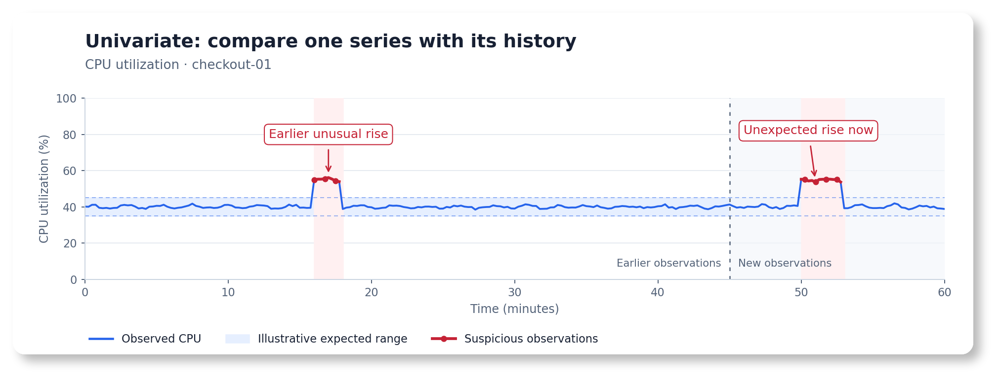
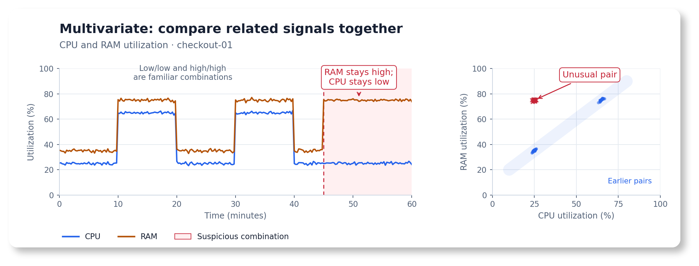
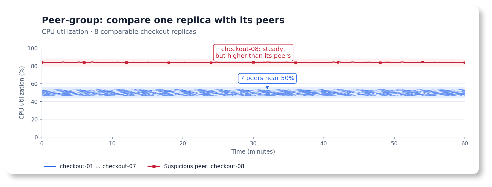

---
build:
  list: never
  publishResources: false
  render: never
sitemap:
  disable: true
---

Start with the operational question you want to answer, then choose a recipe that matches your data. You do not need a machine learning background: each recipe explains what to look for, which model to use, and how to try it before connecting your own metrics.

> [!TIP]
> **Get a starting configuration faster with AI.** Try [AI Copilot in the UI](https://docs.victoriametrics.com/anomaly-detection/ui/#ai-assistance), or use your AI assistant with the [MCP server](https://docs.victoriametrics.com/ai-tools/#vmanomaly-mcp-server) and [agent skills](https://docs.victoriametrics.com/ai-tools/#agent-skills). Ask it to search the docs, inspect your query's data, suggest a model, validate the configuration, and autotune supported parameters.

## Choose what to compare

| Your question | Compare | Start here |
| --- | --- | --- |
| Has this metric changed unexpectedly? | Each series with its own history | [Follow each metric over time](#follow-each-metric-over-time) |
| Are these signals behaving unusually together? | Related signals for the same service or host | [Watch related signals together](#watch-related-signals-together) |
| Is one replica behaving differently from the others? | Comparable entities at the same time | [Find the odd one out](#find-the-odd-one-out) |

These are [univariate](https://docs.victoriametrics.com/anomaly-detection/components/models/#univariate-models "Each series is evaluated independently against its own history."), [multivariate](https://docs.victoriametrics.com/anomaly-detection/components/models/#multivariate-models "Related signals are evaluated together, with a joint decision per group."), and [peer-group](https://docs.victoriametrics.com/anomaly-detection/components/models/#peer-group-models "Comparable entities are evaluated against each other at the same timestamp.") models, respectively. The comparison determines the model type, including when one query returns many series.

> [!NOTE]
> **Inside each recipe in this guide:** a practical use case, when to use or avoid the model, copyable YAML, a reproducible UI playground with the query, model, and schedule already set, expected results, and tuning hints. Expand the sections you need.

For individual parameters, use the [model reference](https://docs.victoriametrics.com/anomaly-detection/components/models/#overview).

## Follow each metric over time

Use this **when each series has its own definition of normal**. For example, a query can return one CPU-utilization series for each of two instances. A separate model is fitted for each series, and anomaly scores are then produced for each instance.



*Suspicious values are compared with this instance's historical range.*

<div class="collapse-group mb-3">

{}

- **SRE:** detect an unexpected rise in CPU utilization for one instance under steady load.
- **APM:** detect a latency increase for a route whose normal response time is stable. Use a seasonal recipe if traffic drives [regular daily changes](https://victoriametrics.com/blog/victoriametrics-anomaly-detection-handbook-chapter-1/#seasonality "A pattern that repeats at regular intervals, such as daily or weekly.").
- **Hardware:** detect an unusual temperature change on one sensor. Retain fixed safety limits for overheating.
- **Business:** detect a drop in a conversion rate. Use a seasonal recipe when the expected rate has [daily or weekly patterns](https://victoriametrics.com/blog/victoriametrics-anomaly-detection-handbook-chapter-1/#seasonality "A pattern that repeats at regular intervals, such as daily or weekly.").

Choose the profile below by inspecting the query's output after aggregation or rate calculation.

{}

</div>

| What normal data looks like | Starting model | Recipe |
| --- | --- | --- |
| One steady level, small fluctuations, few extreme values | [Online Z-score](https://docs.victoriametrics.com/anomaly-detection/components/models/#online-z-score) | [Steady baseline, small fluctuations](#steady-baseline-small-fluctuations) |
| Mostly steady, but occasional extreme values should not distort the baseline | [Online MAD](https://docs.victoriametrics.com/anomaly-detection/components/models/#online-mad) | [Steady baseline with extreme values](#steady-baseline-with-extreme-values) |
| Repeating plateaus with little [trend](https://victoriametrics.com/blog/victoriametrics-anomaly-detection-handbook-chapter-1/#trend "A sustained increase or decrease in the usual level of a time series."), including daily, weekly, or custom cycles, such as a two-week production plan with three-hour operating slots | [Online Seasonal Quantile](https://docs.victoriametrics.com/anomaly-detection/components/models/#online-seasonal-quantile) | [Predictable repeating patterns](#predictable-repeating-patterns) |
| [Trends](https://victoriametrics.com/blog/victoriametrics-anomaly-detection-handbook-chapter-1/#trend "A sustained increase or decrease in the usual level of a time series."), [seasonalities](https://victoriametrics.com/blog/victoriametrics-anomaly-detection-handbook-chapter-1/#seasonality "Patterns that repeat at regular intervals, such as daily or weekly."), changing levels, or additional calendar effects | [Temporal Envelope](https://docs.victoriametrics.com/anomaly-detection/components/models/#temporal-envelope) | [Changing baselines and calendar effects](#changing-baselines-and-calendar-effects) |

### Steady baseline, small fluctuations

**Start with [Online Z-score](https://docs.victoriametrics.com/anomaly-detection/components/models/#online-z-score) (`zscore_online`).** A separate model is fitted for each series to estimate its average level and usual spread. An [anomaly score](https://docs.victoriametrics.com/anomaly-detection/faq/#what-is-anomaly-score "A measure of how unusual an observation is. Scores above 1 cross the model's expected range.") above `1` is assigned to values far enough from that level.

**Example:** CPU utilization normally stays near 45%, with gentle oscillations and point-to-point noise. A brief rise to about 70% or fall to about 25% deserves investigation even though neither reaches an 80% high-CPU threshold. The example query also returns a healthy instance that normally stays near 20%. A separate model is fitted for each series, so each instance is scored against its own history.

<div class="collapse-group mb-3">

{}

- CPU utilization across instances with different normal ranges, learned separately for each instance.
- Request latency for a stable route, after choosing an aggregation and sample interval that avoid sparse or very noisy results.
- Sensor temperatures around a stable operating point.
- Business ratios with enough observations per sample and no strong daily or weekly variation.

The important property is a stable average and spread, without frequent extreme values. Standard deviation is useful for describing the usual variation around that average. Check the threshold against your own data to understand its effect on [false positives](https://victoriametrics.com/blog/victoriametrics-anomaly-detection-handbook-chapter-1/#false-positive "Normal behavior incorrectly flagged as anomalous.").

{}

{}

**Strong patterns, frequent outliers, or sparse samples can make this baseline unreliable.**

- **Large [repeating peaks](https://victoriametrics.com/blog/victoriametrics-anomaly-detection-handbook-chapter-1/#seasonality "A pattern that repeats at regular intervals, such as daily or weekly."):** a single expected range either becomes too wide to catch incidents or flags normal peaks repeatedly. Use [Online Seasonal Quantile](#predictable-repeating-patterns) or [Temporal Envelope](#changing-baselines-and-calendar-effects).
- **Frequent or very large [outliers](https://victoriametrics.com/blog/victoriametrics-anomaly-detection-handbook-chapter-1/#outlier "Values far from most other observations. Their significance depends on context."):** they pull the average and widen its range, potentially hiding later incidents. Consider [Online MAD](#steady-baseline-with-extreme-values).
- **A sustained [trend](https://victoriametrics.com/blog/victoriametrics-anomaly-detection-handbook-chapter-1/#trend "A sustained increase or decrease in the usual level of a time series.") or a new operating level:** this model can initially flag a <strong title="A lasting shift in the usual level or pattern.">changepoint</strong>, then gradually absorb it. Use [Temporal Envelope](#changing-baselines-and-calendar-effects) when these changes are normal.
- **Mostly zero or sparse counts:** check the aggregation interval and event volume first. A standard deviation around a near-zero baseline may not express business significance.

{}

{}

**Two instances, two CPU incidents.**

[Open the prepared metrics playground](https://play-vmanomaly.victoriametrics.com/metrics/vmui/#/?g0.range_input=30d&g0.end_input=2026-01-31T00%3A00%3A00Z&g0.relative_time=none&g0.step_input=15m&g0.tab=0&datasourceUrl=https%3A%2F%2Fplay.victoriametrics.com%2Fselect%2F0%2Fprometheus&query_config=%255B%257B%2522alias%2522%253A%2522cpu_utilization%2522%252C%2522expr%2522%253A%2522WITH%2520%28%255Cn%2520%2520%2523%2520Timestamp-based%2520noise%2520stays%2520the%2520same%2520across%2520fit%2520and%2520display%2520windows.%255Cn%2520%2520mixed%28seed%29%2520%253D%2520sin%28time%28%29%2520%252F%2520900%2520%2A%252012.9898%2520%252B%2520seed%29%2520%2A%252043758.5453%252C%255Cn%2520%2520noise%28seed%29%2520%253D%25200.05%2520%2A%2520%28mixed%28seed%29%2520-%2520floor%28mixed%28seed%29%29%2520-%25200.5%29%252C%255Cn%2520%2520%2523%2520Subtle%2520waves%2520%280.3%2520percentage%2520points%2520each%29%252C%2520without%2520a%2520calendar%2520pattern.%255Cn%2520%2520fluctuation%28seed%29%2520%253D%2520noise%28seed%29%255Cn%2520%2520%2520%2520%252B%25200.003%2520%2A%2520sin%28time%28%29%2520%252F%2520%2811%2520%2A%25203600%29%2520%252B%2520seed%29%255Cn%2520%2520%2520%2520%252B%25200.003%2520%2A%2520sin%28time%28%29%2520%252F%2520%285%2520%2A%25203600%29%2520%252B%2520seed%2520%2A%25200.7%29%252C%255Cn%2520%2520rise%2520%253D%2520%28time%28%29%2520%253E%253D%2520bool%25201768046400%29%2520%2A%2520%28time%28%29%2520%253C%2520bool%25201768057200%29%252C%255Cn%2520%2520fall%2520%253D%2520%28time%28%29%2520%253E%253D%2520bool%25201768888800%29%2520%2A%2520%28time%28%29%2520%253C%2520bool%25201768899600%29%255Cn%29%255Cnlabel_set%280.45%2520%252B%2520fluctuation%2842%29%2520%252B%25200.25%2520%2A%2520rise%2520-%25200.20%2520%2A%2520fall%252C%255Cn%2520%2520%255C%2522__name__%255C%2522%252C%2520%255C%2522demo_cpu_utilization_ratio%255C%2522%252C%2520%255C%2522instance%255C%2522%252C%2520%255C%2522checkout-01%255C%2522%252C%2520%255C%2522service%255C%2522%252C%2520%255C%2522checkout%255C%2522%29%255Cnor%2520label_set%280.20%2520%252B%2520fluctuation%2843%29%252C%255Cn%2520%2520%255C%2522__name__%255C%2522%252C%2520%255C%2522demo_cpu_utilization_ratio%255C%2522%252C%2520%255C%2522instance%255C%2522%252C%2520%255C%2522checkout-02%255C%2522%252C%2520%255C%2522service%255C%2522%252C%2520%255C%2522checkout%255C%2522%29%2522%252C%2522enabled%2522%253Atrue%252C%2522dataRange%2522%253A%255B0%252C1%255D%252C%2522detectionDirection%2522%253A%2522both%2522%252C%2522minDevFromExpected%2522%253A%255B0%252C0%255D%252C%2522minRelDevFromExpected%2522%253A%255B0%252C0%255D%252C%2522policyOverrides%2522%253A%257B%2522dataRange%2522%253Atrue%252C%2522detectionDirection%2522%253Atrue%257D%257D%255D&model_config=%257B%2522modelType%2522%253A%2522zscore_online%2522%252C%2522settings%2522%253A%257B%2522z_threshold%2522%253A3%252C%2522min_n_samples_seen%2522%253A96%252C%2522decay%2522%253A0.998%252C%2522history_strength%2522%253A1.0%257D%252C%2522modelSpec%2522%253A%257B%2522class_name%2522%253A%2522zscore_online%2522%252C%2522z_threshold%2522%253A3%252C%2522min_n_samples_seen%2522%253A96%252C%2522decay%2522%253A0.998%252C%2522history_strength%2522%253A1.0%257D%252C%2522serverModelAlias%2522%253Anull%252C%2522isValidated%2522%253Atrue%257D&fit_window=3d&fit_every=1000w&infer_every=15m&exact=true&anomaly_threshold=1&anomaly_consecutive=true&anomaly_consecutive_points=2&advanced_options_open=true&show_business_boundaries=false).

1. Select **Execute Query** to inspect the two synthetic CPU-utilization series.
2. Select **Detect Anomalies** to run Online Z-score with the prepared settings.
3. Inspect `checkout-01` on **January 10, 2026, 12:00–15:00 UTC** and **January 20, 2026, 06:00–09:00 UTC**. The rise and fall should cross the expected range and have scores above `1`. The other instance should remain within its own range.

| Setting | Prepared value | Why |
| --- | --- | --- |
| Inference range | January 1, 2026, 00:00 UTC → January 31, 2026, 00:00 UTC | Fixed 30-day example |
| Query step | `15m` | Four observations per hour per instance |
| Fit window | `3d` | Initialize from the preceding three days of healthy data |
| Fit every | `1000w` | Longer than this example, so there is one initial fit |
| Exact | `true` | Imitate production scheduling: score chronologically, without future observations updating earlier predictions |
| Infer every | `15m` | Update once per query sample |
| Streaks | On, minimum `2` points | Connect consecutive anomalous points and omit isolated flags |

This [online model](https://docs.victoriametrics.com/anomaly-detection/components/models/#online-models) keeps learning as new data arrives, so regular refits are optional.

Times in this guide are UTC. The UI may display the same instants in your selected timezone.

**What to expect:** gentle oscillations and small noisy deviations stay inside each instance's expected range, without a strong daily or weekly pattern. Each three-hour incident affects twelve observations on `checkout-01`, with consecutive flagged observations connected by a line when Streaks is enabled. Scores may taper as the model learns from the incident. The other instance remains healthy. Values use ratios: `0.45` means 45% CPU utilization. The query generates demonstration data.

The query depends only on timestamps and fixed constants. Its small noise is generated by a deterministic mixing function, so the value at a timestamp is unchanged when the fit and display windows differ. Seeded [`rand`](https://docs.victoriametrics.com/metricsql/#rand) functions reproduce a sequence from the beginning of a request. Changing the request start can assign different values to the same timestamps.

If using your own [UI](https://docs.victoriametrics.com/anomaly-detection/ui/), copy the query from the configuration below and the settings from this table. The public playground needs network access. The configuration remains readable offline.

{}

{}

These **reader**, **models**, and **schedulers** sections use a [periodic scheduler](https://docs.victoriametrics.com/anomaly-detection/components/scheduler/#periodic-scheduler) to score current data continuously. The playground above replays its fixed historical dates with the same fit window and cadence. Keep the writer and license configuration from the [Quickstart](https://docs.victoriametrics.com/anomaly-detection/quickstart/#example). Use a test destination for the demo results written by this configuration.

```yaml
reader:
  class: vm
  datasource_url: https://play.victoriametrics.com/select/0/prometheus
  sampling_period: 15m
  queries:
    cpu_utilization:
      expr: |
        WITH (
          # Timestamp-based noise stays the same across fit and display windows.
          mixed(seed) = sin(time() / 900 * 12.9898 + seed) * 43758.5453,
          noise(seed) = 0.05 * (mixed(seed) - floor(mixed(seed)) - 0.5),
          # Subtle waves (0.3 percentage points each), without a calendar pattern.
          fluctuation(seed) = noise(seed)
            + 0.003 * sin(time() / (11 * 3600) + seed)
            + 0.003 * sin(time() / (5 * 3600) + seed * 0.7),
          rise = (time() >= bool 1768046400) * (time() < bool 1768057200),
          fall = (time() >= bool 1768888800) * (time() < bool 1768899600)
        )
        label_set(0.45 + fluctuation(42) + 0.25 * rise - 0.20 * fall,
          "__name__", "demo_cpu_utilization_ratio", "instance", "checkout-01", "service", "checkout")
        or label_set(0.20 + fluctuation(43),
          "__name__", "demo_cpu_utilization_ratio", "instance", "checkout-02", "service", "checkout")
      detection_direction: both  # When spikes and drops matter. Use above_expected or below_expected for one direction.
      data_range: [0, 1]  # Utilization is expressed as a ratio.

models:
  zscore_steady_cpu:  # Choose a unique alias for this model configuration.
    class: zscore_online  # Select the Online Z-score model.
    queries: [cpu_utilization]  # Connect to one or more aliases defined in reader.queries.
    schedulers: [steady_cpu_demo]  # Connect to one or more aliases defined in schedulers.
    z_threshold: 3  # Set the expected range to three standard deviations from the mean.
    min_n_samples_seen: 96  # One day's worth of 15-minute samples per instance.
    decay: 0.998          # Slower adaptation. History weight halves in ~3.6d at 15m steps.
    history_strength: 1.0  # Give fit history its ordinary weight.

schedulers:
  steady_cpu_demo:
    class: periodic  # Run continuously on incoming data.
    fit_window: 3d
    fit_every: 1000w  # Learning continues between these very infrequent full refits.
    infer_every: 15m
```

`queries` and `schedulers` explicitly bind the model to this example. Query-level [business policies](https://docs.victoriametrics.com/anomaly-detection/components/reader/#per-query-parameters) apply consistently if you later compare models.

For production, replace the synthetic expression with your utilization query, for example `1 - avg by (instance, service) (rate(node_cpu_seconds_total{mode="idle"}[5m]))` if those labels exist in your data. Adjust the inference cadence to your response-time requirements. The deliberately long `fit_every: 1000w` highlights online learning: the model keeps updating between full refits. `fit_window` supplies the initial history at each fit. The model continues learning from observations after that window.

{}

{}

**Give new series time to warm up.** `min_n_samples_seen: 96` requires 96 valid observations per series, including fit data, before non-neutral scoring. At `15m`, that is one day's worth of regularly sampled data. Missing samples extend the wait. Until warmup completes, the score is `0` because the model needs more history. Check warmup status before interpreting zero scores as healthy. The three-day fit normally warms up both demo instances. This recipe uses `96` to allow more warmup than the default `16`.

**Adjust sensitivity.** `z_threshold: 3` places the initial expected range three standard deviations from the mean. Raise it to tolerate larger fluctuations or lower it to investigate smaller changes. Adjust this starting value to your data and investigation needs. Review [false positives](https://victoriametrics.com/blog/victoriametrics-anomaly-detection-handbook-chapter-1/#false-positive "Normal behavior incorrectly flagged as anomalous.") and [false negatives](https://victoriametrics.com/blog/victoriametrics-anomaly-detection-handbook-chapter-1/#false-negative "Actual anomalies that the model does not flag.") (missed incidents) on representative data before enabling alerts.

**Choose how quickly to adapt.** This recipe uses `decay: 0.998` for slower adaptation, helping limit abrupt changes in the expected range after brief incidents. Older information loses half its weight after about 346 new observations (roughly 3.6 days at `15m`). Values closer to `1` adapt more slowly. Setting `1` retains all observations since the latest fit. Faster adaptation can help track an accepted new level, but can also absorb a persistent incident sooner. Retest after changing the sample cadence.

**Weight fit history when appropriate.** `history_strength: 1` gives the fit data its ordinary weight. With representative, similar history, `2` makes that initial evidence twice as influential against subsequent updates. A one-week fit with strength `2` still covers only one week and supplies the same number of valid warmup samples. Use it to adjust adaptation while retaining enough history to cover the patterns you need.

**Apply domain knowledge to each query.** This example uses `detection_direction: both` to show a rise and a fall. Use `above_expected` if only CPU rises matter for your service, or `below_expected` for a conversion-rate drop. Consider [`min_dev_from_expected`](https://docs.victoriametrics.com/anomaly-detection/components/models/#minimal-deviation-from-expected) to ignore negligible changes: for a utilization ratio, `0.02` means two percentage points. Place these policies under `reader.queries.<alias>`.

[Open the spikes-only comparison](https://play-vmanomaly.victoriametrics.com/metrics/vmui/#/?g0.range_input=30d&g0.end_input=2026-01-31T00%3A00%3A00Z&g0.relative_time=none&g0.step_input=15m&g0.tab=0&datasourceUrl=https%3A%2F%2Fplay.victoriametrics.com%2Fselect%2F0%2Fprometheus&query_config=%255B%257B%2522alias%2522%253A%2522cpu_utilization%2522%252C%2522expr%2522%253A%2522WITH%2520%28%255Cn%2520%2520%2523%2520Timestamp-based%2520noise%2520stays%2520the%2520same%2520across%2520fit%2520and%2520display%2520windows.%255Cn%2520%2520mixed%28seed%29%2520%253D%2520sin%28time%28%29%2520%252F%2520900%2520%2A%252012.9898%2520%252B%2520seed%29%2520%2A%252043758.5453%252C%255Cn%2520%2520noise%28seed%29%2520%253D%25200.05%2520%2A%2520%28mixed%28seed%29%2520-%2520floor%28mixed%28seed%29%29%2520-%25200.5%29%252C%255Cn%2520%2520%2523%2520Subtle%2520waves%2520%280.3%2520percentage%2520points%2520each%29%252C%2520without%2520a%2520calendar%2520pattern.%255Cn%2520%2520fluctuation%28seed%29%2520%253D%2520noise%28seed%29%255Cn%2520%2520%2520%2520%252B%25200.003%2520%2A%2520sin%28time%28%29%2520%252F%2520%2811%2520%2A%25203600%29%2520%252B%2520seed%29%255Cn%2520%2520%2520%2520%252B%25200.003%2520%2A%2520sin%28time%28%29%2520%252F%2520%285%2520%2A%25203600%29%2520%252B%2520seed%2520%2A%25200.7%29%252C%255Cn%2520%2520rise%2520%253D%2520%28time%28%29%2520%253E%253D%2520bool%25201768046400%29%2520%2A%2520%28time%28%29%2520%253C%2520bool%25201768057200%29%252C%255Cn%2520%2520fall%2520%253D%2520%28time%28%29%2520%253E%253D%2520bool%25201768888800%29%2520%2A%2520%28time%28%29%2520%253C%2520bool%25201768899600%29%255Cn%29%255Cnlabel_set%280.45%2520%252B%2520fluctuation%2842%29%2520%252B%25200.25%2520%2A%2520rise%2520-%25200.20%2520%2A%2520fall%252C%255Cn%2520%2520%255C%2522__name__%255C%2522%252C%2520%255C%2522demo_cpu_utilization_ratio%255C%2522%252C%2520%255C%2522instance%255C%2522%252C%2520%255C%2522checkout-01%255C%2522%252C%2520%255C%2522service%255C%2522%252C%2520%255C%2522checkout%255C%2522%29%255Cnor%2520label_set%280.20%2520%252B%2520fluctuation%2843%29%252C%255Cn%2520%2520%255C%2522__name__%255C%2522%252C%2520%255C%2522demo_cpu_utilization_ratio%255C%2522%252C%2520%255C%2522instance%255C%2522%252C%2520%255C%2522checkout-02%255C%2522%252C%2520%255C%2522service%255C%2522%252C%2520%255C%2522checkout%255C%2522%29%2522%252C%2522enabled%2522%253Atrue%252C%2522dataRange%2522%253A%255B0%252C1%255D%252C%2522detectionDirection%2522%253A%2522above_expected%2522%252C%2522minDevFromExpected%2522%253A%255B0.02%252C0.02%255D%252C%2522minRelDevFromExpected%2522%253A%255B0%252C0%255D%252C%2522policyOverrides%2522%253A%257B%2522dataRange%2522%253Atrue%252C%2522detectionDirection%2522%253Atrue%252C%2522minDevFromExpected%2522%253Atrue%257D%257D%255D&model_config=%257B%2522modelType%2522%253A%2522zscore_online%2522%252C%2522settings%2522%253A%257B%2522z_threshold%2522%253A3%252C%2522min_n_samples_seen%2522%253A96%252C%2522decay%2522%253A0.998%252C%2522history_strength%2522%253A1.0%257D%252C%2522modelSpec%2522%253A%257B%2522class_name%2522%253A%2522zscore_online%2522%252C%2522z_threshold%2522%253A3%252C%2522min_n_samples_seen%2522%253A96%252C%2522decay%2522%253A0.998%252C%2522history_strength%2522%253A1.0%257D%252C%2522serverModelAlias%2522%253Anull%252C%2522isValidated%2522%253Atrue%257D&fit_window=3d&fit_every=1000w&infer_every=15m&exact=true&anomaly_threshold=1&anomaly_consecutive=true&anomaly_consecutive_points=2&advanced_options_open=true&show_business_boundaries=true). This keeps the same data and model, names the query `cpu_utilization`, and sets **Query overrides** to `detection_direction: above_expected`, `data_range: [0, 1]`, and `min_dev_from_expected: [0.02, 0.02]`. Select **Detect Anomalies**: only the January 10 rise should score above `1`, while the January 20 fall should score `0`. The two-percentage-point minimum deviation is smaller than either incident, so direction is what changes this example's results. To apply these policies in YAML, replace the query's policy fields with:

```yaml
detection_direction: above_expected
data_range: [0, 1]
min_dev_from_expected: [0.02, 0.02]  # Two percentage points of utilization.
```

**Match scheduling to the decision.** The example's `15m` step and inference cadence are for an easy-to-inspect demo. Short incidents may require finer sampling. Slower business KPIs may need coarser aggregation. Keep **Exact** enabled for causal online backtests and set **Infer Every** deliberately. A periodic refit resets learned state using its fit window. Check whether that history contains incidents that could become part of the new baseline.

**Separate detection from paging.** An anomaly score is evidence of unusual behavior. Combine it with impact, persistence, and existing safety or SLO rules when deciding to page. See the [alerting guide](https://docs.victoriametrics.com/anomaly-detection/guides/guide-vmanomaly-vmalert/) and [alert-fatigue guidance](https://docs.victoriametrics.com/anomaly-detection/faq/#preventing-alert-fatigue).

{}

</div>

### Steady baseline with extreme values

**Start with [Online MAD](https://docs.victoriametrics.com/anomaly-detection/components/models/#online-mad) (`mad_online`).** A separate model is fitted for each series to estimate its median and usual distance from that median. Occasional large [outliers](https://victoriametrics.com/blog/victoriametrics-anomaly-detection-handbook-chapter-1/#outlier "Values far from most other observations. Their significance depends on context.") have less influence on this baseline than on an average and standard deviation.

**Example:** checkout request latency normally stays near 200 ms. Two short spikes reach about one second, then latency settles at 260 ms after a deployment. This lasting increase is a <strong title="A lasting shift in the usual level or pattern.">changepoint</strong>. The spikes should not make the later 60 ms regression disappear into a wide normal range. Only increases matter here. Lower latency is welcome.

<div class="collapse-group mb-3">

{}

- Request latency with a stable typical level and sporadic slow samples.
- Processing or queue-wait durations interrupted by occasional long jobs.
- Sensor readings where a few extreme measurements should not distort the baseline.

The baseline should describe most observations. Robustness limits how much an extreme value changes that baseline. The extreme value can still receive a high anomaly score.

{}

{}

**Predictable patterns, multiple operating modes, or sparse samples may need a different model or query.**

- **Strong daily or weekly variation:** use [Online Seasonal Quantile](#predictable-repeating-patterns) or [Temporal Envelope](#changing-baselines-and-calendar-effects), so normal peaks are compared with their calendar context.
- **Normal growth or frequent accepted level changes:** use [Temporal Envelope](#changing-baselines-and-calendar-effects). MAD initially treats an unfamiliar level as unusual and can later learn it. Decide whether a deployment-related change should be accepted based on its impact.
- **Several normal operating modes:** one median and spread can poorly describe their separate ranges. Check whether labels or query aggregation can separate the workloads.
- **Sparse or nearly constant results:** check the sampling interval and set a meaningful minimum deviation. A very narrow learned range can make tiny changes look significant.

{}

{}

**Two latency spikes, then a lasting increase.**

[Open the MAD latency playground](https://play-vmanomaly.victoriametrics.com/metrics/vmui/#/?g0.range_input=30d&g0.end_input=2026-01-31T00%3A00%3A00Z&g0.relative_time=none&g0.step_input=15m&g0.tab=0&datasourceUrl=https%3A%2F%2Fplay.victoriametrics.com%2Fselect%2F0%2Fprometheus&query_config=%255B%257B%2522alias%2522%253A%2522checkout_latency%2522%252C%2522expr%2522%253A%2522WITH%2520%28%255Cn%2520%2520%2523%2520Fixed%2520timestamp-based%2520noise%252C%2520in%2520seconds.%255Cn%2520%2520mixed%2520%253D%2520sin%28time%28%29%2520%252F%2520900%2520%2A%252012.9898%2520%252B%252042%29%2520%2A%252043758.5453%252C%255Cn%2520%2520noise%2520%253D%25200.02%2520%2A%2520%28mixed%2520-%2520floor%28mixed%29%2520-%25200.5%29%252C%255Cn%2520%2520spike_1%2520%253D%2520%28time%28%29%2520%253E%253D%2520bool%25201767873600%29%2520%2A%2520%28time%28%29%2520%253C%2520bool%25201767875400%29%252C%255Cn%2520%2520spike_2%2520%253D%2520%28time%28%29%2520%253E%253D%2520bool%25201768564800%29%2520%2A%2520%28time%28%29%2520%253C%2520bool%25201768566600%29%252C%255Cn%2520%2520changed%2520%253D%2520time%28%29%2520%253E%253D%2520bool%25201768586400%255Cn%29%255Cnlabel_set%280.20%2520%252B%2520noise%2520%252B%25200.80%2520%2A%2520%28spike_1%2520%252B%2520spike_2%29%2520%252B%25200.06%2520%2A%2520changed%252C%255Cn%2520%2520%255C%2522__name__%255C%2522%252C%2520%255C%2522demo_request_duration_seconds%255C%2522%252C%2520%255C%2522quantile%255C%2522%252C%2520%255C%25220.95%255C%2522%252C%255Cn%2520%2520%255C%2522route%255C%2522%252C%2520%255C%2522%252Fcheckout%255C%2522%252C%2520%255C%2522service%255C%2522%252C%2520%255C%2522checkout%255C%2522%29%2522%252C%2522enabled%2522%253Atrue%252C%2522dataRange%2522%253A%255B0%252C5%255D%252C%2522detectionDirection%2522%253A%2522above_expected%2522%252C%2522minDevFromExpected%2522%253A%255B0.02%252C0.02%255D%252C%2522minRelDevFromExpected%2522%253A%255B0%252C0%255D%252C%2522policyOverrides%2522%253A%257B%2522dataRange%2522%253Atrue%252C%2522detectionDirection%2522%253Atrue%252C%2522minDevFromExpected%2522%253Atrue%257D%257D%255D&model_config=%257B%2522modelType%2522%253A%2522mad_online%2522%252C%2522settings%2522%253A%257B%2522threshold%2522%253A5.0%252C%2522min_n_samples_seen%2522%253A96%252C%2522decay%2522%253A0.99%252C%2522history_strength%2522%253A1.0%252C%2522compression%2522%253A100%257D%252C%2522modelSpec%2522%253A%257B%2522class_name%2522%253A%2522mad_online%2522%252C%2522threshold%2522%253A5.0%252C%2522min_n_samples_seen%2522%253A96%252C%2522decay%2522%253A0.99%252C%2522history_strength%2522%253A1.0%252C%2522compression%2522%253A100%257D%252C%2522serverModelAlias%2522%253Anull%252C%2522isValidated%2522%253Atrue%257D&fit_window=3d&fit_every=1000w&infer_every=15m&exact=true&anomaly_threshold=1&anomaly_consecutive=true&anomaly_consecutive_points=2&advanced_options_open=true&show_business_boundaries=true).

1. Select **Execute Query** to inspect one synthetic latency series, named `checkout_latency`.
2. Select **Detect Anomalies** to run Online MAD with the prepared settings.
3. Inspect the two spikes on **January 8 and January 16, 2026, 12:00–12:30 UTC**, then the lasting increase starting **January 16, 18:00 UTC**. MAD should flag both spikes and the beginning of the new level.

| Setting | Prepared value | Why |
| --- | --- | --- |
| Inference range | January 1 → January 31, 2026, UTC | Fixed 30-day comparison |
| Query step / infer every | `15m` / `15m` | Score each observation chronologically |
| Fit window / fit every | `3d` / `1000w` | One initial fit from the preceding three days |
| Exact | `true` | Imitate production scheduling without future observations changing earlier predictions |
| Streaks | On, minimum `2` points | Show the two-point spikes and consecutive flags after the shift |
| Query policies | Above expected, minimum deviation `0.02` seconds | Ignore improvements and changes smaller than 20 ms |

This [online model](https://docs.victoriametrics.com/anomaly-detection/components/models/#online-models) keeps learning as new data arrives, so regular refits are optional.

**What to expect:** values use seconds: `0.2` means 200 ms. The series has timestamp-based noise, two 30-minute spikes, and a permanent 60 ms increase. There is no trend or calendar pattern to learn. As new observations arrive, the expected range can move and widen until the new level is no longer flagged. Use latency or SLO checks to confirm that the regression has been resolved.

[Compare with Online Z-score](https://play-vmanomaly.victoriametrics.com/metrics/vmui/#/?g0.range_input=30d&g0.end_input=2026-01-31T00%3A00%3A00Z&g0.relative_time=none&g0.step_input=15m&g0.tab=0&datasourceUrl=https%3A%2F%2Fplay.victoriametrics.com%2Fselect%2F0%2Fprometheus&query_config=%255B%257B%2522alias%2522%253A%2522checkout_latency%2522%252C%2522expr%2522%253A%2522WITH%2520%28%255Cn%2520%2520%2523%2520Fixed%2520timestamp-based%2520noise%252C%2520in%2520seconds.%255Cn%2520%2520mixed%2520%253D%2520sin%28time%28%29%2520%252F%2520900%2520%2A%252012.9898%2520%252B%252042%29%2520%2A%252043758.5453%252C%255Cn%2520%2520noise%2520%253D%25200.02%2520%2A%2520%28mixed%2520-%2520floor%28mixed%29%2520-%25200.5%29%252C%255Cn%2520%2520spike_1%2520%253D%2520%28time%28%29%2520%253E%253D%2520bool%25201767873600%29%2520%2A%2520%28time%28%29%2520%253C%2520bool%25201767875400%29%252C%255Cn%2520%2520spike_2%2520%253D%2520%28time%28%29%2520%253E%253D%2520bool%25201768564800%29%2520%2A%2520%28time%28%29%2520%253C%2520bool%25201768566600%29%252C%255Cn%2520%2520changed%2520%253D%2520time%28%29%2520%253E%253D%2520bool%25201768586400%255Cn%29%255Cnlabel_set%280.20%2520%252B%2520noise%2520%252B%25200.80%2520%2A%2520%28spike_1%2520%252B%2520spike_2%29%2520%252B%25200.06%2520%2A%2520changed%252C%255Cn%2520%2520%255C%2522__name__%255C%2522%252C%2520%255C%2522demo_request_duration_seconds%255C%2522%252C%2520%255C%2522quantile%255C%2522%252C%2520%255C%25220.95%255C%2522%252C%255Cn%2520%2520%255C%2522route%255C%2522%252C%2520%255C%2522%252Fcheckout%255C%2522%252C%2520%255C%2522service%255C%2522%252C%2520%255C%2522checkout%255C%2522%29%2522%252C%2522enabled%2522%253Atrue%252C%2522dataRange%2522%253A%255B0%252C5%255D%252C%2522detectionDirection%2522%253A%2522above_expected%2522%252C%2522minDevFromExpected%2522%253A%255B0.02%252C0.02%255D%252C%2522minRelDevFromExpected%2522%253A%255B0%252C0%255D%252C%2522policyOverrides%2522%253A%257B%2522dataRange%2522%253Atrue%252C%2522detectionDirection%2522%253Atrue%252C%2522minDevFromExpected%2522%253Atrue%257D%257D%255D&model_config=%257B%2522modelType%2522%253A%2522zscore_online%2522%252C%2522settings%2522%253A%257B%2522min_n_samples_seen%2522%253A96%252C%2522decay%2522%253A0.99%252C%2522history_strength%2522%253A1.0%252C%2522z_threshold%2522%253A3.0%257D%252C%2522modelSpec%2522%253A%257B%2522class_name%2522%253A%2522zscore_online%2522%252C%2522min_n_samples_seen%2522%253A96%252C%2522decay%2522%253A0.99%252C%2522history_strength%2522%253A1.0%252C%2522z_threshold%2522%253A3.0%257D%252C%2522serverModelAlias%2522%253Anull%252C%2522isValidated%2522%253Atrue%257D&fit_window=3d&fit_every=1000w&infer_every=15m&exact=true&anomaly_threshold=1&anomaly_consecutive=true&anomaly_consecutive_points=2&advanced_options_open=true&show_business_boundaries=true). The comparison keeps the query, policies, dates, schedule, and decay the same, while changing the model and its threshold. The large spikes widen the Z-score range, which can hide the smaller increase that follows. Compare the expected ranges at the start of the level change. MAD's `threshold` and Z-score's `z_threshold` measure different spreads and need separate tuning.

{}

{}

These **reader**, **models**, and **schedulers** sections use a periodic scheduler for continuous scoring. The playground above replays the dated latency example with the same fit window and cadence. Keep the writer and license settings from the [Quickstart](https://docs.victoriametrics.com/anomaly-detection/quickstart/#example) and use a test writer destination, as in the previous recipe.

```yaml
reader:
  class: vm
  datasource_url: https://play.victoriametrics.com/select/0/prometheus
  sampling_period: 15m
  queries:
    checkout_latency:
      expr: |
        WITH (
          # Fixed timestamp-based noise, in seconds.
          mixed = sin(time() / 900 * 12.9898 + 42) * 43758.5453,
          noise = 0.02 * (mixed - floor(mixed) - 0.5),
          spike_1 = (time() >= bool 1767873600) * (time() < bool 1767875400),
          spike_2 = (time() >= bool 1768564800) * (time() < bool 1768566600),
          changed = time() >= bool 1768586400
        )
        label_set(0.20 + noise + 0.80 * (spike_1 + spike_2) + 0.06 * changed,
          "__name__", "demo_request_duration_seconds", "quantile", "0.95",
          "route", "/checkout", "service", "checkout")
      detection_direction: above_expected  # Flag slower requests while allowing faster ones.
      min_dev_from_expected: [0.02, 0.02]  # Ignore deviations smaller than 20 ms.
      data_range: [0, 5]  # This demo service has a five-second request timeout.

models:
  mad_checkout_latency:
    class: mad_online
    queries: [checkout_latency]
    schedulers: [latency_demo]
    threshold: 5.0  # Multiplier of median absolute deviation, not standard deviation.
    min_n_samples_seen: 96  # One day's worth of 15-minute samples.
    decay: 0.99  # Favor recent observations so sustained changes can become normal.
    history_strength: 1.0
    compression: 100  # Starting accuracy/memory tradeoff for approximate quantiles.

schedulers:
  latency_demo:
    class: periodic  # Run continuously on incoming data.
    fit_window: 3d
    fit_every: 1000w  # Learning continues between these very infrequent full refits.
    infer_every: 15m
```

For the Z-score comparison, replace `class: mad_online` with `class: zscore_online`, replace `threshold: 5.0` with `z_threshold: 3.0`, and remove `compression`. Keep the query policies and schedule unchanged. Replace the generated expression with your latency query when applying the recipe to real data. Preserve its units and aggregation meaning.

{}

{}

**Start with representative history and warmup.** The three-day fit contains healthy data and exceeds `min_n_samples_seen: 96`. New series need 96 valid observations before non-neutral scores. Missing observations delay warmup. Include ordinary variability in fit history. A perfectly flat fit can produce an overly narrow range.

**Tune sensitivity in MAD units.** `threshold: 5.0` is a starting point for this query. Increase it to tolerate more variation or decrease it to investigate smaller departures. MAD measures distance from the median, so tune its threshold for the spread of your data. Check [false positives](https://victoriametrics.com/blog/victoriametrics-anomaly-detection-handbook-chapter-1/#false-positive "Normal behavior incorrectly flagged as anomalous.") and missed incidents on representative data.

**Set business significance in the query's units.** `detection_direction: above_expected` allows latency improvements. `min_dev_from_expected: [0.02, 0.02]` measures a 20 ms minimum distance from the expected value. A sample must also cross the model's expected range to be flagged. The two limits work together. See [minimum deviation](https://docs.victoriametrics.com/anomaly-detection/components/models/#minimal-deviation-from-expected).

**Decide how long a new level should remain unusual.** With `decay: 0.99`, recent observations gain influence and a persistent increase can be absorbed. Values closer to `1` retain older evidence longer. Setting `history_strength` above `1` strengthens the initial fit history without adding time coverage. A shorter refit interval can also reset the baseline from recent data. Backtest these settings against the time you need to investigate a regression. Use impact or SLO checks to confirm recovery.

**Keep persistence separate from severity.** Streaks controls how consecutive flags are displayed in the UI. Configure alert persistence separately. The two large spikes can still be anomalies even though they barely move MAD's baseline. Decide whether to page using impact and persistence, and retain latency or SLO rules for regressions that must stay actionable after the model adapts. See the [alerting guide](https://docs.victoriametrics.com/anomaly-detection/guides/guide-vmanomaly-vmalert/).

{}

</div>

### Predictable repeating patterns

**Start with [Online Seasonal Quantile](https://docs.victoriametrics.com/anomaly-detection/components/models/#online-seasonal-quantile) (`quantile_online`).** Choose this for **repeating plateaus**, where the usual level stays roughly constant within each time slot. A separate expected range is learned for each slot in the [repeating cycle](https://victoriametrics.com/blog/victoriametrics-anomaly-detection-handbook-chapter-1/#seasonality "A pattern that repeats at regular intervals, such as daily or weekly."). Predictions form steps whose levels gradually update as new observations arrive.

**Example:** checkout traffic stays near 50 requests/s overnight and 200 requests/s during opening hours, 09:00–19:00 UTC. A drop to 50 during opening hours or a rise to 200 at night is a [contextual anomaly](https://victoriametrics.com/blog/victoriametrics-anomaly-detection-handbook-chapter-2/#contextual-anomalies "A value that is unusual for its context, such as the time of day, even if ordinary at other times."): the value is familiar, but its timing is unusual. The query also returns a healthy region with its own lower levels. Each series is modeled separately.

<div class="collapse-group mb-3">

{}

- Service traffic that switches between fairly steady opening-hours and overnight levels.
- Scheduled batch-processing throughput with repeatable active and idle periods.
- Hardware power usage that follows a stable shift schedule.
- Business activity with repeatable daily or weekly operating windows.
- Custom production cycles: for a line whose product mix and processing/cleaning schedule repeat every two weeks, three-hour slots can capture the usual throughput or power usage for each stage.

The normal level and spread should be fairly consistent when the same time slot returns. Place bucket boundaries at changes between operating periods, so each bucket mostly contains one normal level.

{}

{}

**Smooth curves, mixed time slots, or changing baselines can make step-shaped predictions a poor fit.**

- **Smooth [seasonal curves](https://victoriametrics.com/blog/victoriametrics-anomaly-detection-handbook-chapter-1/#seasonality "Patterns that repeat at regular intervals, such as daily or weekly."), such as sinusoids:** one nearly horizontal range covers the whole bucket. If the signal moves substantially within that interval, the expected value can be too high at one end and too low at the other. Narrow bounds can flag normal movement, while wide bounds can hide smaller incidents. Consider [Temporal Envelope](#changing-baselines-and-calendar-effects) for smooth patterns.
- **Neighboring hours with different normal levels:** a two-hour bucket can mix an hour near 50 requests/s with one near 200. Its shared center may represent neither hour well, and its range can become wide enough to accept both levels at the wrong time. Smaller, correctly aligned buckets help, provided enough history is available for each.
- **Normal [growth](https://victoriametrics.com/blog/victoriametrics-anomaly-detection-handbook-chapter-1/#trend "A sustained increase or decrease in the usual level of a time series."), shifting operating hours, or frequent level changes:** use [Temporal Envelope](#changing-baselines-and-calendar-effects) when these changes are expected. Fixed seasonal slots work best when the same operating periods recur.
- **Little repeated history or sparse samples:** a bucket cannot learn a dependable range from a few observations. Check aggregation and cycle coverage before making the buckets smaller.

Mixing different normal phases can widen the range and hide incidents. Robust quantiles reduce the influence of extreme values. Use suitable bucket boundaries to preserve the time context.

**See the smooth-curve limitation.** [Open the smooth-curve example with four-hour buckets](https://play-vmanomaly.victoriametrics.com/metrics/vmui/#/?g0.range_input=14d&g0.end_input=2026-01-17T00%3A00%3A00Z&g0.relative_time=none&g0.step_input=15m&g0.tab=0&datasourceUrl=https%3A%2F%2Fplay.victoriametrics.com%2Fselect%2F0%2Fprometheus&query_config=%255B%257B%2522alias%2522%253A%2522checkout_request_rate%2522%252C%2522expr%2522%253A%2522WITH%2520%28%255Cn%2520%2520hour_utc%2520%253D%2520%28time%28%29%2520%2525%252086400%29%2520%252F%25203600%252C%255Cn%2520%2520%2523%2520A%2520smooth%2520daily%2520cycle%2520from%252050%2520to%2520200%2520requests%252Fs%252C%2520peaking%2520at%2520noon.%255Cn%2520%2520baseline%2520%253D%2520125%2520%252B%252075%2520%2A%2520sin%28%28hour_utc%2520-%25206%29%2520%252F%252024%2520%2A%25206.283185307179586%29%252C%255Cn%2520%2520mixed%2520%253D%2520sin%28time%28%29%2520%252F%2520900%2520%2A%252012.9898%2520%252B%252042%29%2520%2A%252043758.5453%252C%255Cn%2520%2520noise%2520%253D%252010%2520%2A%2520%28mixed%2520-%2520floor%28mixed%29%2520-%25200.5%29%252C%255Cn%2520%2520slowdown%2520%253D%2520%28time%28%29%2520%253E%253D%2520bool%25201768041000%29%2520%2A%2520%28time%28%29%2520%253C%2520bool%25201768044600%29%255Cn%29%255Cnlabel_set%28baseline%2520%252B%2520noise%2520-%252030%2520%2A%2520slowdown%252C%255Cn%2520%2520%255C%2522__name__%255C%2522%252C%2520%255C%2522demo_http_requests_per_second%255C%2522%252C%2520%255C%2522region%255C%2522%252C%2520%255C%2522eu-west%255C%2522%252C%2520%255C%2522service%255C%2522%252C%2520%255C%2522checkout%255C%2522%29%2522%252C%2522enabled%2522%253Atrue%252C%2522dataRange%2522%253A%255B0%252C500%255D%252C%2522detectionDirection%2522%253A%2522both%2522%252C%2522minDevFromExpected%2522%253A%255B0%252C0%255D%252C%2522minRelDevFromExpected%2522%253A%255B10%252C10%255D%252C%2522policyOverrides%2522%253A%257B%2522dataRange%2522%253Atrue%252C%2522detectionDirection%2522%253Atrue%252C%2522minRelDevFromExpected%2522%253Atrue%257D%257D%255D&model_config=%257B%2522modelType%2522%253A%2522quantile_online%2522%252C%2522settings%2522%253A%257B%2522seasonal_interval%2522%253A%25221d%2522%252C%2522min_subseason%2522%253A%25224h%2522%252C%2522season_starts_from%2522%253A%25222026-01-01%2522%252C%2522quantiles%2522%253A%255B0.25%252C0.5%252C0.75%255D%252C%2522iqr_threshold%2522%253A2.0%252C%2522global_smoothing%2522%253A0.0%252C%2522min_n_samples_seen%2522%253A96%252C%2522decay%2522%253A0.99%252C%2522history_strength%2522%253A1.0%252C%2522compression%2522%253A100%252C%2522clip_predictions%2522%253Atrue%257D%252C%2522modelSpec%2522%253A%257B%2522class_name%2522%253A%2522quantile_online%2522%252C%2522seasonal_interval%2522%253A%25221d%2522%252C%2522min_subseason%2522%253A%25224h%2522%252C%2522season_starts_from%2522%253A%25222026-01-01%2522%252C%2522quantiles%2522%253A%255B0.25%252C0.5%252C0.75%255D%252C%2522iqr_threshold%2522%253A2.0%252C%2522global_smoothing%2522%253A0.0%252C%2522min_n_samples_seen%2522%253A96%252C%2522decay%2522%253A0.99%252C%2522history_strength%2522%253A1.0%252C%2522compression%2522%253A100%252C%2522clip_predictions%2522%253Atrue%257D%252C%2522serverModelAlias%2522%253Anull%252C%2522isValidated%2522%253Atrue%257D&fit_window=14d&fit_every=1000w&infer_every=15m&exact=true&anomaly_threshold=1&anomaly_consecutive=true&anomaly_consecutive_points=2&advanced_options_open=true&show_business_boundaries=true). Select **Detect Anomalies**, then inspect **January 10, 2026, 10:30–11:30 UTC**. A 30 requests/s drop in otherwise smooth daily traffic can stay inside the broad range learned for 08:00–12:00. [Compare the same curve with one-hour buckets](https://play-vmanomaly.victoriametrics.com/metrics/vmui/#/?g0.range_input=14d&g0.end_input=2026-01-17T00%3A00%3A00Z&g0.relative_time=none&g0.step_input=15m&g0.tab=0&datasourceUrl=https%3A%2F%2Fplay.victoriametrics.com%2Fselect%2F0%2Fprometheus&query_config=%255B%257B%2522alias%2522%253A%2522checkout_request_rate%2522%252C%2522expr%2522%253A%2522WITH%2520%28%255Cn%2520%2520hour_utc%2520%253D%2520%28time%28%29%2520%2525%252086400%29%2520%252F%25203600%252C%255Cn%2520%2520%2523%2520A%2520smooth%2520daily%2520cycle%2520from%252050%2520to%2520200%2520requests%252Fs%252C%2520peaking%2520at%2520noon.%255Cn%2520%2520baseline%2520%253D%2520125%2520%252B%252075%2520%2A%2520sin%28%28hour_utc%2520-%25206%29%2520%252F%252024%2520%2A%25206.283185307179586%29%252C%255Cn%2520%2520mixed%2520%253D%2520sin%28time%28%29%2520%252F%2520900%2520%2A%252012.9898%2520%252B%252042%29%2520%2A%252043758.5453%252C%255Cn%2520%2520noise%2520%253D%252010%2520%2A%2520%28mixed%2520-%2520floor%28mixed%29%2520-%25200.5%29%252C%255Cn%2520%2520slowdown%2520%253D%2520%28time%28%29%2520%253E%253D%2520bool%25201768041000%29%2520%2A%2520%28time%28%29%2520%253C%2520bool%25201768044600%29%255Cn%29%255Cnlabel_set%28baseline%2520%252B%2520noise%2520-%252030%2520%2A%2520slowdown%252C%255Cn%2520%2520%255C%2522__name__%255C%2522%252C%2520%255C%2522demo_http_requests_per_second%255C%2522%252C%2520%255C%2522region%255C%2522%252C%2520%255C%2522eu-west%255C%2522%252C%2520%255C%2522service%255C%2522%252C%2520%255C%2522checkout%255C%2522%29%2522%252C%2522enabled%2522%253Atrue%252C%2522dataRange%2522%253A%255B0%252C500%255D%252C%2522detectionDirection%2522%253A%2522both%2522%252C%2522minDevFromExpected%2522%253A%255B0%252C0%255D%252C%2522minRelDevFromExpected%2522%253A%255B10%252C10%255D%252C%2522policyOverrides%2522%253A%257B%2522dataRange%2522%253Atrue%252C%2522detectionDirection%2522%253Atrue%252C%2522minRelDevFromExpected%2522%253Atrue%257D%257D%255D&model_config=%257B%2522modelType%2522%253A%2522quantile_online%2522%252C%2522settings%2522%253A%257B%2522seasonal_interval%2522%253A%25221d%2522%252C%2522min_subseason%2522%253A%25221h%2522%252C%2522season_starts_from%2522%253A%25222026-01-01%2522%252C%2522quantiles%2522%253A%255B0.25%252C0.5%252C0.75%255D%252C%2522iqr_threshold%2522%253A2.0%252C%2522global_smoothing%2522%253A0.0%252C%2522min_n_samples_seen%2522%253A96%252C%2522decay%2522%253A0.99%252C%2522history_strength%2522%253A1.0%252C%2522compression%2522%253A100%252C%2522clip_predictions%2522%253Atrue%257D%252C%2522modelSpec%2522%253A%257B%2522class_name%2522%253A%2522quantile_online%2522%252C%2522seasonal_interval%2522%253A%25221d%2522%252C%2522min_subseason%2522%253A%25221h%2522%252C%2522season_starts_from%2522%253A%25222026-01-01%2522%252C%2522quantiles%2522%253A%255B0.25%252C0.5%252C0.75%255D%252C%2522iqr_threshold%2522%253A2.0%252C%2522global_smoothing%2522%253A0.0%252C%2522min_n_samples_seen%2522%253A96%252C%2522decay%2522%253A0.99%252C%2522history_strength%2522%253A1.0%252C%2522compression%2522%253A100%252C%2522clip_predictions%2522%253Atrue%257D%252C%2522serverModelAlias%2522%253Anull%252C%2522isValidated%2522%253Atrue%257D&fit_window=14d&fit_every=1000w&infer_every=15m&exact=true&anomaly_threshold=1&anomaly_consecutive=true&anomaly_consecutive_points=2&advanced_options_open=true&show_business_boundaries=true). Smaller buckets reveal the drop but can also flag normal within-hour movement. Set the Streaks minimum to `1` to inspect isolated flags.

These links use one region and the query below, shown over January 3–17, 2026, UTC to keep the slowdown near the center. They retain the recipe's 14-day fit history, quantiles, and 10% relative-deviation policy. Only the bucket width differs between the two links. For the coarse model settings, replace the query in the configuration below and set `min_subseason: 4h`.

```metricsql
WITH (
  hour_utc = (time() % 86400) / 3600,
  # A smooth daily cycle from 50 to 200 requests/s, peaking at noon.
  baseline = 125 + 75 * sin((hour_utc - 6) / 24 * 6.283185307179586),
  mixed = sin(time() / 900 * 12.9898 + 42) * 43758.5453,
  noise = 10 * (mixed - floor(mixed) - 0.5),
  slowdown = (time() >= bool 1768041000) * (time() < bool 1768044600)
)
label_set(baseline + noise - 30 * slowdown,
  "__name__", "demo_http_requests_per_second", "region", "eu-west", "service", "checkout")
```

{}

{}

**Two regions, daily plateaus, and values arriving at the wrong time.**

[Open the plateau-pattern playground](https://play-vmanomaly.victoriametrics.com/metrics/vmui/#/?g0.range_input=14d&g0.end_input=2026-01-22T00%3A00%3A00Z&g0.relative_time=none&g0.step_input=15m&g0.tab=0&datasourceUrl=https%3A%2F%2Fplay.victoriametrics.com%2Fselect%2F0%2Fprometheus&query_config=%255B%257B%2522alias%2522%253A%2522checkout_request_rate%2522%252C%2522expr%2522%253A%2522WITH%2520%28%255Cn%2520%2520hour_utc%2520%253D%2520%28time%28%29%2520%2525%252086400%29%2520%252F%25203600%252C%255Cn%2520%2520open%2520%253D%2520%28hour_utc%2520%253E%253D%2520bool%25209%29%2520%2A%2520%28hour_utc%2520%253C%2520bool%252019%29%252C%255Cn%2520%2520baseline%2520%253D%252050%2520%252B%2520150%2520%2A%2520open%252C%255Cn%2520%2520%2523%2520Small%2520timestamp-based%2520noise%252C%2520in%2520requests%2520per%2520second.%255Cn%2520%2520mixed%28seed%29%2520%253D%2520sin%28time%28%29%2520%252F%2520900%2520%2A%252012.9898%2520%252B%2520seed%29%2520%2A%252043758.5453%252C%255Cn%2520%2520noise%28seed%29%2520%253D%252010%2520%2A%2520%28mixed%28seed%29%2520-%2520floor%28mixed%28seed%29%29%2520-%25200.5%29%252C%255Cn%2520%2520daytime_drop%2520%253D%2520%28time%28%29%2520%253E%253D%2520bool%25201768035600%29%2520%2A%2520%28time%28%29%2520%253C%2520bool%25201768039200%29%252C%255Cn%2520%2520nighttime_rise%2520%253D%2520%28time%28%29%2520%253E%253D%2520bool%25201768874400%29%2520%2A%2520%28time%28%29%2520%253C%2520bool%25201768885200%29%255Cn%29%255Cnlabel_set%28baseline%2520%252B%2520noise%2842%29%2520-%2520150%2520%2A%2520daytime_drop%2520%252B%2520150%2520%2A%2520nighttime_rise%252C%255Cn%2520%2520%255C%2522__name__%255C%2522%252C%2520%255C%2522demo_http_requests_per_second%255C%2522%252C%2520%255C%2522region%255C%2522%252C%2520%255C%2522eu-west%255C%2522%252C%2520%255C%2522service%255C%2522%252C%2520%255C%2522checkout%255C%2522%29%255Cnor%2520label_set%280.6%2520%2A%2520baseline%2520%252B%2520noise%2843%29%252C%255Cn%2520%2520%255C%2522__name__%255C%2522%252C%2520%255C%2522demo_http_requests_per_second%255C%2522%252C%2520%255C%2522region%255C%2522%252C%2520%255C%2522eu-east%255C%2522%252C%2520%255C%2522service%255C%2522%252C%2520%255C%2522checkout%255C%2522%29%2522%252C%2522enabled%2522%253Atrue%252C%2522dataRange%2522%253A%255B0%252C500%255D%252C%2522detectionDirection%2522%253A%2522both%2522%252C%2522minDevFromExpected%2522%253A%255B0%252C0%255D%252C%2522minRelDevFromExpected%2522%253A%255B10%252C10%255D%252C%2522policyOverrides%2522%253A%257B%2522dataRange%2522%253Atrue%252C%2522detectionDirection%2522%253Atrue%252C%2522minRelDevFromExpected%2522%253Atrue%257D%257D%255D&model_config=%257B%2522modelType%2522%253A%2522quantile_online%2522%252C%2522settings%2522%253A%257B%2522seasonal_interval%2522%253A%25221d%2522%252C%2522min_subseason%2522%253A%25221h%2522%252C%2522season_starts_from%2522%253A%25222026-01-01%2522%252C%2522quantiles%2522%253A%255B0.25%252C0.5%252C0.75%255D%252C%2522iqr_threshold%2522%253A2.0%252C%2522global_smoothing%2522%253A0.0%252C%2522min_n_samples_seen%2522%253A96%252C%2522decay%2522%253A0.99%252C%2522history_strength%2522%253A1.0%252C%2522compression%2522%253A100%252C%2522clip_predictions%2522%253Atrue%257D%252C%2522modelSpec%2522%253A%257B%2522class_name%2522%253A%2522quantile_online%2522%252C%2522seasonal_interval%2522%253A%25221d%2522%252C%2522min_subseason%2522%253A%25221h%2522%252C%2522season_starts_from%2522%253A%25222026-01-01%2522%252C%2522quantiles%2522%253A%255B0.25%252C0.5%252C0.75%255D%252C%2522iqr_threshold%2522%253A2.0%252C%2522global_smoothing%2522%253A0.0%252C%2522min_n_samples_seen%2522%253A96%252C%2522decay%2522%253A0.99%252C%2522history_strength%2522%253A1.0%252C%2522compression%2522%253A100%252C%2522clip_predictions%2522%253Atrue%257D%252C%2522serverModelAlias%2522%253Anull%252C%2522isValidated%2522%253Atrue%257D&fit_window=14d&fit_every=1000w&infer_every=15m&exact=true&anomaly_threshold=1&anomaly_consecutive=true&anomaly_consecutive_points=2&advanced_options_open=true&show_business_boundaries=true).

1. Select **Execute Query** to inspect `checkout_request_rate` for two regions. Both switch between overnight and opening-hours plateaus.
2. Select **Detect Anomalies** to run Online Seasonal Quantile with one-hour buckets.
3. Inspect `eu-west` on **January 10, 2026, 09:00–10:00 UTC**, when traffic drops to the overnight level, and **January 20, 02:00–05:00 UTC**, when it rises to the opening-hours level. Both incidents should cross the expected range. The regular daily transitions and `eu-east` should remain unflagged.

| Setting | Prepared value | Why |
| --- | --- | --- |
| Inference range | January 8 → January 22, 2026, UTC | Two weeks covering both incidents |
| Query step / infer every | `15m` / `15m` | Four observations per hour per series |
| Fit window / fit every | `14d` / `1000w` | Initialize from fourteen daily cycles, with no refit during the example |
| Seasonal interval / bucket | `1d` / `1h` | Keep 24 separate clock-hour ranges per series |
| Exact | `true` | Process observations chronologically, imitating production scheduling |
| Streaks | On, minimum `2` points | Connect consecutive flags in each incident |
| Query policies | Both directions, minimum relative deviation `10%` | Scale tolerance to each region's expected traffic |

This [online model](https://docs.victoriametrics.com/anomaly-detection/components/models/#online-models) keeps learning as new data arrives, so regular refits are optional.

**What to expect:** the expected range steps between the low and high plateaus at 09:00 and 19:00 UTC. The daytime incident affects four observations, and the nighttime incident affects twelve. Values use requests per second. The two regions have separate expected ranges, even though one query returns both series.

[Compare with two-hour buckets](https://play-vmanomaly.victoriametrics.com/metrics/vmui/#/?g0.range_input=14d&g0.end_input=2026-01-22T00%3A00%3A00Z&g0.relative_time=none&g0.step_input=15m&g0.tab=0&datasourceUrl=https%3A%2F%2Fplay.victoriametrics.com%2Fselect%2F0%2Fprometheus&query_config=%255B%257B%2522alias%2522%253A%2522checkout_request_rate%2522%252C%2522expr%2522%253A%2522WITH%2520%28%255Cn%2520%2520hour_utc%2520%253D%2520%28time%28%29%2520%2525%252086400%29%2520%252F%25203600%252C%255Cn%2520%2520open%2520%253D%2520%28hour_utc%2520%253E%253D%2520bool%25209%29%2520%2A%2520%28hour_utc%2520%253C%2520bool%252019%29%252C%255Cn%2520%2520baseline%2520%253D%252050%2520%252B%2520150%2520%2A%2520open%252C%255Cn%2520%2520%2523%2520Small%2520timestamp-based%2520noise%252C%2520in%2520requests%2520per%2520second.%255Cn%2520%2520mixed%28seed%29%2520%253D%2520sin%28time%28%29%2520%252F%2520900%2520%2A%252012.9898%2520%252B%2520seed%29%2520%2A%252043758.5453%252C%255Cn%2520%2520noise%28seed%29%2520%253D%252010%2520%2A%2520%28mixed%28seed%29%2520-%2520floor%28mixed%28seed%29%29%2520-%25200.5%29%252C%255Cn%2520%2520daytime_drop%2520%253D%2520%28time%28%29%2520%253E%253D%2520bool%25201768035600%29%2520%2A%2520%28time%28%29%2520%253C%2520bool%25201768039200%29%252C%255Cn%2520%2520nighttime_rise%2520%253D%2520%28time%28%29%2520%253E%253D%2520bool%25201768874400%29%2520%2A%2520%28time%28%29%2520%253C%2520bool%25201768885200%29%255Cn%29%255Cnlabel_set%28baseline%2520%252B%2520noise%2842%29%2520-%2520150%2520%2A%2520daytime_drop%2520%252B%2520150%2520%2A%2520nighttime_rise%252C%255Cn%2520%2520%255C%2522__name__%255C%2522%252C%2520%255C%2522demo_http_requests_per_second%255C%2522%252C%2520%255C%2522region%255C%2522%252C%2520%255C%2522eu-west%255C%2522%252C%2520%255C%2522service%255C%2522%252C%2520%255C%2522checkout%255C%2522%29%255Cnor%2520label_set%280.6%2520%2A%2520baseline%2520%252B%2520noise%2843%29%252C%255Cn%2520%2520%255C%2522__name__%255C%2522%252C%2520%255C%2522demo_http_requests_per_second%255C%2522%252C%2520%255C%2522region%255C%2522%252C%2520%255C%2522eu-east%255C%2522%252C%2520%255C%2522service%255C%2522%252C%2520%255C%2522checkout%255C%2522%29%2522%252C%2522enabled%2522%253Atrue%252C%2522dataRange%2522%253A%255B0%252C500%255D%252C%2522detectionDirection%2522%253A%2522both%2522%252C%2522minDevFromExpected%2522%253A%255B0%252C0%255D%252C%2522minRelDevFromExpected%2522%253A%255B10%252C10%255D%252C%2522policyOverrides%2522%253A%257B%2522dataRange%2522%253Atrue%252C%2522detectionDirection%2522%253Atrue%252C%2522minRelDevFromExpected%2522%253Atrue%257D%257D%255D&model_config=%257B%2522modelType%2522%253A%2522quantile_online%2522%252C%2522settings%2522%253A%257B%2522seasonal_interval%2522%253A%25221d%2522%252C%2522min_subseason%2522%253A%25222h%2522%252C%2522season_starts_from%2522%253A%25222026-01-01%2522%252C%2522quantiles%2522%253A%255B0.25%252C0.5%252C0.75%255D%252C%2522iqr_threshold%2522%253A2.0%252C%2522global_smoothing%2522%253A0.0%252C%2522min_n_samples_seen%2522%253A96%252C%2522decay%2522%253A0.99%252C%2522history_strength%2522%253A1.0%252C%2522compression%2522%253A100%252C%2522clip_predictions%2522%253Atrue%257D%252C%2522modelSpec%2522%253A%257B%2522class_name%2522%253A%2522quantile_online%2522%252C%2522seasonal_interval%2522%253A%25221d%2522%252C%2522min_subseason%2522%253A%25222h%2522%252C%2522season_starts_from%2522%253A%25222026-01-01%2522%252C%2522quantiles%2522%253A%255B0.25%252C0.5%252C0.75%255D%252C%2522iqr_threshold%2522%253A2.0%252C%2522global_smoothing%2522%253A0.0%252C%2522min_n_samples_seen%2522%253A96%252C%2522decay%2522%253A0.99%252C%2522history_strength%2522%253A1.0%252C%2522compression%2522%253A100%252C%2522clip_predictions%2522%253Atrue%257D%252C%2522serverModelAlias%2522%253Anull%252C%2522isValidated%2522%253Atrue%257D&fit_window=14d&fit_every=1000w&infer_every=15m&exact=true&anomaly_threshold=1&anomaly_consecutive=true&anomaly_consecutive_points=2&advanced_options_open=true&show_business_boundaries=true). Only `min_subseason` changes from `1h` to `2h`. Inspect 08:00–10:00 and 18:00–20:00 UTC: each coarse bucket now covers an hour from each plateau. Compare the wider range and less representative expected value with the one-hour version. The January 10 drop can disappear into that mixed range, even though its business meaning is unchanged.

{}

{}

These **reader**, **models**, and **schedulers** sections use a periodic scheduler for continuous scoring. The playground above replays the dated plateau example with the same fit window and cadence. Keep the writer and license settings from the [Quickstart](https://docs.victoriametrics.com/anomaly-detection/quickstart/#example), and use a test writer destination.

```yaml
reader:
  class: vm
  datasource_url: https://play.victoriametrics.com/select/0/prometheus
  sampling_period: 15m
  queries:
    checkout_request_rate:
      expr: |
        WITH (
          hour_utc = (time() % 86400) / 3600,
          open = (hour_utc >= bool 9) * (hour_utc < bool 19),
          baseline = 50 + 150 * open,
          # Small timestamp-based noise, in requests per second.
          mixed(seed) = sin(time() / 900 * 12.9898 + seed) * 43758.5453,
          noise(seed) = 10 * (mixed(seed) - floor(mixed(seed)) - 0.5),
          daytime_drop = (time() >= bool 1768035600) * (time() < bool 1768039200),
          nighttime_rise = (time() >= bool 1768874400) * (time() < bool 1768885200)
        )
        label_set(baseline + noise(42) - 150 * daytime_drop + 150 * nighttime_rise,
          "__name__", "demo_http_requests_per_second", "region", "eu-west", "service", "checkout")
        or label_set(0.6 * baseline + noise(43),
          "__name__", "demo_http_requests_per_second", "region", "eu-east", "service", "checkout")
      detection_direction: both  # Unexpected traffic rises and falls both matter.
      min_rel_dev_from_expected: [10, 10]  # Ignore deviations smaller than 10% below/above the expected value.
      data_range: [0, 500]  # Demo intake's configured capacity is 500 requests/s.

models:
  quantile_daily_traffic:  # Choose a unique model alias.
    class: quantile_online  # Select Online Seasonal Quantile.
    queries: [checkout_request_rate]  # Connect to one or more reader query aliases.
    schedulers: [daily_traffic_demo]  # Connect to one or more scheduler aliases.
    seasonal_interval: 1d  # Repeat the same daily pattern.
    min_subseason: 1h  # Keep a separate range for each clock hour.
    season_starts_from: '2026-01-01'  # Align the demo's buckets to UTC midnight.
    quantiles: [0.25, 0.5, 0.75]  # Robust lower, central, and upper estimates.
    iqr_threshold: 2.0  # Widen the range to tolerate ordinary within-bucket noise.
    global_smoothing: 0.0  # Keep the time-specific ranges separate from the overall range.
    min_n_samples_seen: 96  # Total valid observations required before non-neutral scoring.
    decay: 0.99  # Let each time slot gradually adapt as it is observed again.
    history_strength: 1.0  # Give the initial fit its ordinary weight.
    compression: 100  # Starting accuracy/memory tradeoff for approximate quantiles.
    clip_predictions: true  # Keep predicted ranges within the query's valid data range.

schedulers:
  daily_traffic_demo:
    class: periodic  # Run continuously on incoming data.
    fit_window: 14d  # Fourteen daily cycles with 56 samples per hour slot.
    fit_every: 1000w  # Learning continues between these very infrequent full refits.
    infer_every: 15m
```

For the coarse-bucket comparison, change only `min_subseason: 1h` to `min_subseason: 2h`. For real traffic, replace the generated expression with your request-rate query, for example `sum by (region, service) (rate(http_requests_total{service="checkout"}[5m]))` if those labels exist. Choose the cycle and buckets from the resulting series, after aggregation.

{}

{}

**Align buckets with operating periods.** `min_subseason` sets the bucket width independently of the query step. Here `1h` holds four `15m` observations from the same clock hour each day. It divides `seasonal_interval: 1d` into 24 slots. A two-hour bucket mixes the 08:00 overnight hour with the 09:00 opening hour. Smaller buckets can follow a smooth curve more closely, but need more repeated cycles to estimate each slot reliably.

**Use custom cycles when the operation calls for them.** The cycle need not be a day or a week. For the two-week production plan above, `seasonal_interval: 2w` and `min_subseason: 3h` create 112 separate slots. Set `season_starts_from` to the plan's actual starting date and time, and use several complete cycles as fit history. For example, `fit_window: 6w` covers three repetitions. The slot width must divide the full cycle evenly, and its boundaries should keep different operating stages separate.

**Cover every slot before relying on it.** The `14d` fit supplies fourteen daily cycles and about 56 observations per hour slot. `min_n_samples_seen: 96` checks the total observations seen by a model. Inspect each bucket separately to confirm that it has enough observations. For a weekly schedule, use a weekly cycle with enough history to observe each weekday and weekend slot repeatedly. Increasing `history_strength` cannot supply missing weekdays or unseen operating periods.

**Use quantiles and IQR together.** The middle quantiles `[0.25, 0.5, 0.75]` reduce the influence of a few extreme values. `iqr_threshold` expands the resulting range using the spread within each bucket. Increasing it tolerates more variation but can hide incidents. Very wide quantiles near `0` and `1` can let rare extremes widen the range. Neither choice fixes a bucket that contains two different normal levels.

**Scale business tolerance with the expected traffic.** [`min_rel_dev_from_expected: [10, 10]`](https://docs.victoriametrics.com/anomaly-detection/components/models/#minimal-relative-deviation-from-expected) ignores deviations smaller than 10% below or above the expected value. That is about 5 requests/s when 50 is expected, or 20 requests/s when 200 is expected. The percentage is measured from the expected value. A sample must exceed both this tolerance and the model's expected range to be flagged.

**Distinguish global blending from a smooth seasonal curve.** `global_smoothing: 0` uses each slot's own distribution. Increasing it blends in the distribution across all times, which can reduce the contrast between overnight and opening-hours predictions. The bucket boundaries still produce steps.

**Match time and cadence to the schedule.** The generated pattern and bucket alignment use UTC. The UI may display those same instants in another timezone. Check local operating hours, daylight-saving changes, and the cycle reference point when applying the recipe. Keep the query step and inference cadence deliberate: changing them changes how many observations each slot receives.

**Let accepted changes adapt gradually.** `decay` below `1` gives new observations more influence when their slot is updated. A slot seen only during one clock hour adapts on a different wall-clock timescale from a continuously updated Z-score baseline. If changing levels or moving schedules are part of normal behavior, consider [Temporal Envelope](#changing-baselines-and-calendar-effects).

{}

</div>

### Changing baselines and calendar effects

**Start with [Temporal Envelope](https://docs.victoriametrics.com/anomaly-detection/components/models/#temporal-envelope) (`temporal_envelope`).** Choose this **when normal behavior combines growth, changing levels, and calendar patterns**. The expected range can follow a [trend](https://victoriametrics.com/blog/victoriametrics-anomaly-detection-handbook-chapter-1/#trend "A sustained increase or decrease in the usual level of a time series."), smooth or step-shaped [seasonalities](https://victoriametrics.com/blog/victoriametrics-anomaly-detection-handbook-chapter-1/#seasonality "Patterns that repeat at regular intervals, such as daily or weekly."), and persistent level shifts together. Each series is modeled independently in this recipe.

**Example:** checkout traffic grows gradually, rises and falls smoothly each day, and is lower on weekends. A traffic migration adds a lasting 35 requests/s from January 12. That new level may initially be flagged, then learned. A separate three-hour surge and three-hour drop should still stand out from the evolving daily pattern.

<div class="collapse-group mb-3">

{}

- Service traffic with smooth daily demand, weekday/weekend differences, and gradual growth.
- CPU or power usage whose usual range changes with workload and calendar schedules.
- Business activity with recurring calendar effects and an evolving normal level.
- Metrics affected by accepted traffic migrations or capacity changes, when a new level should eventually become normal.

The model learns what the metric usually does at that time and how its baseline evolves. Decide which persistent shifts should become normal based on their business impact.

{}

{}

**A simpler baseline, a custom cycle, or a different comparison better matches the question.**

- **Stable data without calendar patterns:** start with [Online Z-score](#steady-baseline-small-fluctuations) or [Online MAD](#steady-baseline-with-extreme-values). Their simpler ranges can be easier to inspect and tune.
- **Fixed plateaus or custom-duration cycles dominate:** consider [Online Seasonal Quantile](#predictable-repeating-patterns), especially for schedules such as a repeating two-week production plan with three-hour slots. Temporal Envelope's seasonal presets follow calendar patterns. Seasonal Quantile also supports custom-duration cycles.
- **The relationship between signals matters:** use [multivariate models](#watch-related-signals-together). An independently plausible CPU value and RAM value can still form an unusual pair.
- **One entity differs from comparable entities now:** use a [peer-group model](#find-the-odd-one-out) when the comparison should be with its peers at the same timestamp.

{}

{}

**A growing service, daily and weekend patterns, a new level, and two brief incidents.**

[Open the Temporal Envelope playground](https://play-vmanomaly.victoriametrics.com/metrics/vmui/#/?g0.range_input=14d&g0.end_input=2026-01-22T00%3A00%3A00Z&g0.relative_time=none&g0.step_input=15m&g0.tab=0&datasourceUrl=https%3A%2F%2Fplay.victoriametrics.com%2Fselect%2F0%2Fprometheus&query_config=%255B%257B%2522alias%2522%253A%2522checkout_evolving_rate%2522%252C%2522expr%2522%253A%2522WITH%2520%28%255Cn%2520%2520hour_utc%2520%253D%2520%28time%28%29%2520%2525%252086400%29%2520%252F%25203600%252C%255Cn%2520%2520days_since_start%2520%253D%2520%28time%28%29%2520-%25201767225600%29%2520%252F%252086400%252C%255Cn%2520%2520%2523%2520Unix%2520epoch%2520was%2520Thursday.%2520Number%2520weekdays%2520from%2520Monday%253D0%2520to%2520Sunday%253D6.%255Cn%2520%2520weekday%2520%253D%2520floor%28time%28%29%2520%252F%252086400%2520%252B%25203%29%2520%2525%25207%252C%255Cn%2520%2520weekend%2520%253D%2520weekday%2520%253E%253D%2520bool%25205%252C%255Cn%2520%2520daily%2520%253D%252060%2520%2A%2520sin%28%28hour_utc%2520-%25206%29%2520%252F%252024%2520%2A%25206.283185307179586%29%252C%255Cn%2520%2520baseline%2520%253D%2520150%2520%252B%25202%2520%2A%2520days_since_start%2520%252B%2520daily%2520-%252025%2520%2A%2520weekend%252C%255Cn%2520%2520mixed%2520%253D%2520sin%28time%28%29%2520%252F%2520900%2520%2A%252012.9898%2520%252B%252042%29%2520%2A%252043758.5453%252C%255Cn%2520%2520noise%2520%253D%252010%2520%2A%2520%28mixed%2520-%2520floor%28mixed%29%2520-%25200.5%29%252C%255Cn%2520%2520migration%2520%253D%2520time%28%29%2520%253E%253D%2520bool%25201768176000%252C%255Cn%2520%2520surge%2520%253D%2520%28time%28%29%2520%253E%253D%2520bool%25201768730400%29%2520%2A%2520%28time%28%29%2520%253C%2520bool%25201768741200%29%252C%255Cn%2520%2520drop%2520%253D%2520%28time%28%29%2520%253E%253D%2520bool%25201768874400%29%2520%2A%2520%28time%28%29%2520%253C%2520bool%25201768885200%29%255Cn%29%255Cnlabel_set%28baseline%2520%252B%2520noise%2520%252B%252035%2520%2A%2520migration%2520%252B%2520100%2520%2A%2520surge%2520-%252070%2520%2A%2520drop%252C%255Cn%2520%2520%255C%2522__name__%255C%2522%252C%2520%255C%2522demo_http_requests_per_second%255C%2522%252C%2520%255C%2522region%255C%2522%252C%2520%255C%2522eu-west%255C%2522%252C%2520%255C%2522service%255C%2522%252C%2520%255C%2522checkout%255C%2522%29%2522%252C%2522enabled%2522%253Atrue%252C%2522dataRange%2522%253A%255B0%252C500%255D%252C%2522detectionDirection%2522%253A%2522both%2522%252C%2522minDevFromExpected%2522%253A%255B0%252C0%255D%252C%2522minRelDevFromExpected%2522%253A%255B10%252C10%255D%252C%2522policyOverrides%2522%253A%257B%2522dataRange%2522%253Atrue%252C%2522detectionDirection%2522%253Atrue%252C%2522minRelDevFromExpected%2522%253Atrue%257D%257D%255D&model_config=%257B%2522modelType%2522%253A%2522temporal_envelope%2522%252C%2522settings%2522%253A%257B%2522seasonalities%2522%253A%255B%2522hod_smooth%2522%252C%2522weekpart_plateau%2522%255D%252C%2522quantiles%2522%253A%255B0.25%252C0.75%255D%252C%2522iqr_threshold%2522%253A2.0%252C%2522alpha%2522%253A0.005%252C%2522loss_reactivity%2522%253A3.0%252C%2522changepoint_window%2522%253A16%252C%2522min_n_samples_seen%2522%253A96%252C%2522clip_predictions%2522%253Atrue%257D%252C%2522modelSpec%2522%253A%257B%2522class_name%2522%253A%2522temporal_envelope%2522%252C%2522seasonalities%2522%253A%255B%2522hod_smooth%2522%252C%2522weekpart_plateau%2522%255D%252C%2522quantiles%2522%253A%255B0.25%252C0.75%255D%252C%2522iqr_threshold%2522%253A2.0%252C%2522alpha%2522%253A0.005%252C%2522loss_reactivity%2522%253A3.0%252C%2522changepoint_window%2522%253A16%252C%2522min_n_samples_seen%2522%253A96%252C%2522clip_predictions%2522%253Atrue%257D%252C%2522serverModelAlias%2522%253Anull%252C%2522isValidated%2522%253Atrue%257D&fit_window=28d&fit_every=1000w&infer_every=15m&exact=true&anomaly_threshold=1&anomaly_consecutive=true&anomaly_consecutive_points=2&advanced_options_open=true&show_business_boundaries=true).

1. Select **Execute Query** to inspect `checkout_evolving_rate`. The two-week view shows smooth daily cycles over a rising baseline, with lower weekend traffic.
2. Select **Detect Anomalies** to fit and run Temporal Envelope chronologically.
3. Inspect the lasting increase from **January 12, 2026, 00:00 UTC**, then the surge on **January 18, 10:00–13:00 UTC** and drop on **January 20, 02:00–05:00 UTC**. Compare the learned expected range before and after the level change, and during the two brief incidents.

| Setting | Prepared value | Why |
| --- | --- | --- |
| Inference range | January 8 → January 22, 2026, UTC | A focused two-week view of the changes |
| Query step / infer every | `15m` / `15m` | Score each observation in order |
| Fit window / fit every | `28d` / `1000w` | Four weeks of daily and weekend context, with one initial fit |
| Seasonalities | `hod_smooth`, `weekpart_plateau` | A smooth hour-of-day pattern plus weekday/weekend levels |
| Exact | `true` | Imitate production scheduling without future observations changing earlier predictions |
| Streaks | On, minimum `2` points | Connect consecutive incident flags |
| Query policies | Both directions, minimum relative deviation `10%` | Scale business tolerance with the expected traffic |

This [online model](https://docs.victoriametrics.com/anomaly-detection/components/models/#online-models) keeps learning as new data arrives, so regular refits are optional.

**What to expect:** the center follows the daily curve and gradual growth. The January 12 increase is a <strong title="A lasting shift in the usual level or pattern.">changepoint</strong>. It can receive high scores before the model adapts. The later short surge and drop are separate departures from the new baseline. Scores can fade during an incident, and returning to normal can briefly be flagged while the model catches up. The query is deterministic, and values use requests per second. Use impact and SLO checks to confirm recovery after a lasting change, as the score can fall through adaptation.

{}

{}

These **reader**, **models**, and **schedulers** sections use a periodic scheduler for continuous scoring. The playground above replays the dated traffic example with the same fit window and cadence. Keep the writer and license settings from the [Quickstart](https://docs.victoriametrics.com/anomaly-detection/quickstart/#example), and use a test writer destination.

```yaml
reader:
  class: vm
  datasource_url: https://play.victoriametrics.com/select/0/prometheus
  sampling_period: 15m
  queries:
    checkout_evolving_rate:
      expr: |
        WITH (
          hour_utc = (time() % 86400) / 3600,
          days_since_start = (time() - 1767225600) / 86400,
          # Unix epoch was Thursday. Number weekdays from Monday=0 to Sunday=6.
          weekday = floor(time() / 86400 + 3) % 7,
          weekend = weekday >= bool 5,
          daily = 60 * sin((hour_utc - 6) / 24 * 6.283185307179586),
          baseline = 150 + 2 * days_since_start + daily - 25 * weekend,
          mixed = sin(time() / 900 * 12.9898 + 42) * 43758.5453,
          noise = 10 * (mixed - floor(mixed) - 0.5),
          migration = time() >= bool 1768176000,
          surge = (time() >= bool 1768730400) * (time() < bool 1768741200),
          drop = (time() >= bool 1768874400) * (time() < bool 1768885200)
        )
        label_set(baseline + noise + 35 * migration + 100 * surge - 70 * drop,
          "__name__", "demo_http_requests_per_second", "region", "eu-west", "service", "checkout")
      detection_direction: both  # Investigate unexpected surges and drops.
      min_rel_dev_from_expected: [10, 10]  # Require at least 10% deviation from the expected value.
      data_range: [0, 500]  # Demo intake's configured capacity is 500 requests/s.

models:
  envelope_checkout_rate:  # Choose a unique model alias.
    class: temporal_envelope  # Select univariate Temporal Envelope.
    queries: [checkout_evolving_rate]  # Connect to one or more reader query aliases.
    schedulers: [evolving_traffic_demo]  # Connect to one or more scheduler aliases.
    seasonalities: [hod_smooth, weekpart_plateau]  # Daily curves and weekday/weekend levels.
    quantiles: [0.25, 0.75]  # Lower and upper residual quantiles. The center is learned separately.
    iqr_threshold: 2.0  # Control the width of the expected range.
    alpha: 0.005  # Trend Reactivity: how quickly the baseline follows lasting changes.
    loss_reactivity: 3.0  # Limit how strongly brief deviations influence learning.
    changepoint_window: 16  # Look for a lasting shift over 16 observations, about four hours here.
    min_n_samples_seen: 96  # Require one day's worth of valid observations before non-neutral scoring.
    clip_predictions: true  # Keep predicted ranges within the query's valid data range.

schedulers:
  evolving_traffic_demo:
    class: periodic  # Run continuously on incoming data.
    fit_window: 28d  # Four repetitions of the weekly pattern.
    fit_every: 1000w  # Learning continues between these very infrequent full refits.
    infer_every: 15m
```

For production, replace the generated expression with your request-rate query and choose history that covers the calendar patterns you enable. The deliberately long `fit_every: 1000w` highlights learning between full refits. Adjust sampling and scheduling to the decisions you need to make.

{}

{}

**Check each behavior separately.** Inspect normal daily/weekend cycles, adaptation to the migration, and detection of the brief surge and drop. Recheck all three after changing one setting.

**Use representative calendar context.** Enable patterns covered by fit history, and set the query's [`tz`](https://docs.victoriametrics.com/anomaly-detection/components/reader/#per-query-parameters) for local operating hours. Add holiday context when the metric responds to those events and representative history is available.

For range width, reactivity, shift detection, and warmup settings, use the [Temporal Envelope parameter reference](https://docs.victoriametrics.com/anomaly-detection/components/models/#temporal-envelope). Keep impact or SLO alerts for changes that must remain actionable after the model adapts.

{}

</div>

## Watch related signals together

Use [multivariate models](https://docs.victoriametrics.com/anomaly-detection/components/models/#multivariate-models) **when the relationship between aligned inputs matters**. Start with multivariate [Temporal Envelope](https://docs.victoriametrics.com/anomaly-detection/components/models/#temporal-envelope) (`temporal_envelope_multivariate`). The related series in each group are modeled together, and one joint anomaly score is produced per group.



*CPU and RAM normally rise and fall together. Low CPU with high RAM is a suspicious combination, even though both values have occurred before.*

<div class="collapse-group mb-3">

{}

- **SRE:** RAM utilization stays high while CPU falls on a replica where they usually rise and fall together.
- **APM:** request rate falls while CPU remains high. Either value may look ordinary alone, but their combination can indicate wasted work or a stuck process.
- **Hardware:** fan speed no longer rises as temperature increases on a host.
- **Business:** purchase rate falls while checkout attempts stay steady.

Inputs need consistent identities, timestamps, and grouping. Keep a stable set of related signals in each group. For changing populations of comparable entities, use [peer-group models](#find-the-odd-one-out).

{}

</div>

### Changes in relationships between signals

**Start with multivariate [Temporal Envelope](https://docs.victoriametrics.com/anomaly-detection/components/models/#temporal-envelope) (`temporal_envelope_multivariate`).** Choose this **when familiar values form an unfamiliar combination**. A separate model is fitted for each worker pool using light-job rate, heavy-job rate, and CPU utilization together.

**Example:** an image-processing service creates small thumbnails and performs more expensive full-resolution processing. Total throughput stays near 100 jobs per second, but the mix changes. CPU per total job naturally varies because heavy jobs cost more. Each pool learns its usual combination of job rates and CPU. For six hours on `render-a`, the reported job mix and CPU no longer agree, although all three signals stay within familiar ranges. Investigate a change in processing cost, background work, or job classification. `render-b` keeps its usual relationship.

<div class="collapse-group mb-3">

{}

- Light-job rate, heavy-job rate, and CPU when processing cost depends on the work mix.
- Request rates for different endpoint classes and resource use when endpoints have different costs.
- Checkout attempts and completed purchases when their relationship is more useful than either count alone.

Check the relationship in healthy data first. Compare signals for the same scope and interval. Include representative workload mixes and enough observations for the model to learn their variation.

{}

{}

**The inputs are unrelated, membership changes, or a known rule already describes the relationship.**

- **Each signal needs its own decision:** use a [per-series recipe](#follow-each-metric-over-time).
- **You need to compare interchangeable replicas now:** use a [peer-group model](#find-the-odd-one-out). Here, each pool is compared with its own learned job-mix behavior.
- **A stable cost equation is already known:** monitor its residual directly. A learned model can help when the expected relationship and its variation differ between pools and must be estimated from data.
- **Input identities or timing are inconsistent:** fix aggregation, alignment, and missing channels before fitting a joint model.

{}

{}

**Two worker pools, three named queries, and a change in their relationship.** [Open the multivariate playground](https://play-vmanomaly.victoriametrics.com/metrics/vmui/#/?g0.range_input=3d&g0.end_input=2026-01-17T00%3A00%3A00Z&g0.relative_time=none&g0.step_input=1h&g0.tab=0&datasourceUrl=https%3A%2F%2Fplay.victoriametrics.com%2Fselect%2F0%2Fprometheus&query_config=%255B%257B%2522alias%2522%253A%2522light_jobs%2522%252C%2522expr%2522%253A%2522WITH%2520%28%255Cn%2520%2520mixed%28seed%29%2520%253D%2520sin%28time%28%29%2520%252F%25203600%2520%2A%252012.9898%2520%252B%2520seed%29%2520%2A%252043758.5453%252C%255Cn%2520%2520unit%28seed%29%2520%253D%2520mixed%28seed%29%2520-%2520floor%28mixed%28seed%29%29%252C%255Cn%2520%2520total%28seed%29%2520%253D%252095%2520%252B%252010%2520%2A%2520unit%28seed%29%252C%255Cn%2520%2520mix%28seed%29%2520%253D%25200.10%2520%252B%25200.20%2520%2A%2520unit%28seed%2520%252B%252010%29%252C%255Cn%2520%2520noise%28seed%29%2520%253D%25200.002%2520%2A%2520%28unit%28seed%2520%252B%252020%29%2520-%25200.5%29%252C%255Cn%2520%2520incident%2520%253D%2520%28time%28%29%2520%253E%253D%2520bool%25201768471200%29%2520%2A%2520%28time%28%29%2520%253C%2520bool%25201768492800%29%252C%255Cn%2520%2520reported_mix%28seed%252C%2520event%29%2520%253D%25200.10%2520%252B%25200.20%2520%2A%2520%28%28unit%28seed%2520%252B%252010%29%2520%252B%25200.5%2520%2A%2520event%29%2520%2525%25201%29%252C%255Cn%2520%2520light%28seed%252C%2520event%29%2520%253D%2520total%28seed%29%2520%2A%2520%281%2520-%2520reported_mix%28seed%252C%2520event%29%29%252C%255Cn%2520%2520heavy%28seed%252C%2520event%29%2520%253D%2520total%28seed%29%2520%2A%2520reported_mix%28seed%252C%2520event%29%252C%255Cn%2520%2520cpu_a%2520%253D%25200.12%2520%252B%2520total%2842%29%2520%2A%2520%280.001%2520%252B%25200.007%2520%2A%2520mix%2842%29%29%2520%252B%2520noise%2842%29%252C%255Cn%2520%2520cpu_b%2520%253D%25200.08%2520%252B%2520total%2843%29%2520%2A%2520%280.002%2520%252B%25200.004%2520%2A%2520mix%2843%29%29%2520%252B%2520noise%2843%29%255Cn%29%255Cnlabel_set%28light%2842%252C%2520incident%29%252C%2520%255C%2522__name__%255C%2522%252C%2520%255C%2522demo_completed_jobs_per_second%255C%2522%252C%2520%255C%2522service%255C%2522%252C%2520%255C%2522image-processing%255C%2522%252C%2520%255C%2522pool%255C%2522%252C%2520%255C%2522render-a%255C%2522%252C%2520%255C%2522job_type%255C%2522%252C%2520%255C%2522thumbnail%255C%2522%29%255Cnor%2520label_set%28light%2843%252C%25200%29%252C%2520%255C%2522__name__%255C%2522%252C%2520%255C%2522demo_completed_jobs_per_second%255C%2522%252C%2520%255C%2522service%255C%2522%252C%2520%255C%2522image-processing%255C%2522%252C%2520%255C%2522pool%255C%2522%252C%2520%255C%2522render-b%255C%2522%252C%2520%255C%2522job_type%255C%2522%252C%2520%255C%2522thumbnail%255C%2522%29%2522%252C%2522enabled%2522%253Atrue%252C%2522dataRange%2522%253A%255B0%252C200%255D%252C%2522detectionDirection%2522%253A%2522both%2522%252C%2522minDevFromExpected%2522%253A%255B0%252C0%255D%252C%2522minRelDevFromExpected%2522%253A%255B0%252C0%255D%252C%2522policyOverrides%2522%253A%257B%2522dataRange%2522%253Atrue%252C%2522detectionDirection%2522%253Atrue%257D%257D%252C%257B%2522alias%2522%253A%2522heavy_jobs%2522%252C%2522expr%2522%253A%2522WITH%2520%28%255Cn%2520%2520mixed%28seed%29%2520%253D%2520sin%28time%28%29%2520%252F%25203600%2520%2A%252012.9898%2520%252B%2520seed%29%2520%2A%252043758.5453%252C%255Cn%2520%2520unit%28seed%29%2520%253D%2520mixed%28seed%29%2520-%2520floor%28mixed%28seed%29%29%252C%255Cn%2520%2520total%28seed%29%2520%253D%252095%2520%252B%252010%2520%2A%2520unit%28seed%29%252C%255Cn%2520%2520mix%28seed%29%2520%253D%25200.10%2520%252B%25200.20%2520%2A%2520unit%28seed%2520%252B%252010%29%252C%255Cn%2520%2520noise%28seed%29%2520%253D%25200.002%2520%2A%2520%28unit%28seed%2520%252B%252020%29%2520-%25200.5%29%252C%255Cn%2520%2520incident%2520%253D%2520%28time%28%29%2520%253E%253D%2520bool%25201768471200%29%2520%2A%2520%28time%28%29%2520%253C%2520bool%25201768492800%29%252C%255Cn%2520%2520reported_mix%28seed%252C%2520event%29%2520%253D%25200.10%2520%252B%25200.20%2520%2A%2520%28%28unit%28seed%2520%252B%252010%29%2520%252B%25200.5%2520%2A%2520event%29%2520%2525%25201%29%252C%255Cn%2520%2520light%28seed%252C%2520event%29%2520%253D%2520total%28seed%29%2520%2A%2520%281%2520-%2520reported_mix%28seed%252C%2520event%29%29%252C%255Cn%2520%2520heavy%28seed%252C%2520event%29%2520%253D%2520total%28seed%29%2520%2A%2520reported_mix%28seed%252C%2520event%29%252C%255Cn%2520%2520cpu_a%2520%253D%25200.12%2520%252B%2520total%2842%29%2520%2A%2520%280.001%2520%252B%25200.007%2520%2A%2520mix%2842%29%29%2520%252B%2520noise%2842%29%252C%255Cn%2520%2520cpu_b%2520%253D%25200.08%2520%252B%2520total%2843%29%2520%2A%2520%280.002%2520%252B%25200.004%2520%2A%2520mix%2843%29%29%2520%252B%2520noise%2843%29%255Cn%29%255Cnlabel_set%28heavy%2842%252C%2520incident%29%252C%2520%255C%2522__name__%255C%2522%252C%2520%255C%2522demo_completed_jobs_per_second%255C%2522%252C%2520%255C%2522service%255C%2522%252C%2520%255C%2522image-processing%255C%2522%252C%2520%255C%2522pool%255C%2522%252C%2520%255C%2522render-a%255C%2522%252C%2520%255C%2522job_type%255C%2522%252C%2520%255C%2522full-resolution%255C%2522%29%255Cnor%2520label_set%28heavy%2843%252C%25200%29%252C%2520%255C%2522__name__%255C%2522%252C%2520%255C%2522demo_completed_jobs_per_second%255C%2522%252C%2520%255C%2522service%255C%2522%252C%2520%255C%2522image-processing%255C%2522%252C%2520%255C%2522pool%255C%2522%252C%2520%255C%2522render-b%255C%2522%252C%2520%255C%2522job_type%255C%2522%252C%2520%255C%2522full-resolution%255C%2522%29%2522%252C%2522enabled%2522%253Atrue%252C%2522dataRange%2522%253A%255B0%252C60%255D%252C%2522detectionDirection%2522%253A%2522both%2522%252C%2522minDevFromExpected%2522%253A%255B0%252C0%255D%252C%2522minRelDevFromExpected%2522%253A%255B0%252C0%255D%252C%2522policyOverrides%2522%253A%257B%2522dataRange%2522%253Atrue%252C%2522detectionDirection%2522%253Atrue%257D%257D%252C%257B%2522alias%2522%253A%2522worker_cpu%2522%252C%2522expr%2522%253A%2522WITH%2520%28%255Cn%2520%2520mixed%28seed%29%2520%253D%2520sin%28time%28%29%2520%252F%25203600%2520%2A%252012.9898%2520%252B%2520seed%29%2520%2A%252043758.5453%252C%255Cn%2520%2520unit%28seed%29%2520%253D%2520mixed%28seed%29%2520-%2520floor%28mixed%28seed%29%29%252C%255Cn%2520%2520total%28seed%29%2520%253D%252095%2520%252B%252010%2520%2A%2520unit%28seed%29%252C%255Cn%2520%2520mix%28seed%29%2520%253D%25200.10%2520%252B%25200.20%2520%2A%2520unit%28seed%2520%252B%252010%29%252C%255Cn%2520%2520noise%28seed%29%2520%253D%25200.002%2520%2A%2520%28unit%28seed%2520%252B%252020%29%2520-%25200.5%29%252C%255Cn%2520%2520incident%2520%253D%2520%28time%28%29%2520%253E%253D%2520bool%25201768471200%29%2520%2A%2520%28time%28%29%2520%253C%2520bool%25201768492800%29%252C%255Cn%2520%2520reported_mix%28seed%252C%2520event%29%2520%253D%25200.10%2520%252B%25200.20%2520%2A%2520%28%28unit%28seed%2520%252B%252010%29%2520%252B%25200.5%2520%2A%2520event%29%2520%2525%25201%29%252C%255Cn%2520%2520light%28seed%252C%2520event%29%2520%253D%2520total%28seed%29%2520%2A%2520%281%2520-%2520reported_mix%28seed%252C%2520event%29%29%252C%255Cn%2520%2520heavy%28seed%252C%2520event%29%2520%253D%2520total%28seed%29%2520%2A%2520reported_mix%28seed%252C%2520event%29%252C%255Cn%2520%2520cpu_a%2520%253D%25200.12%2520%252B%2520total%2842%29%2520%2A%2520%280.001%2520%252B%25200.007%2520%2A%2520mix%2842%29%29%2520%252B%2520noise%2842%29%252C%255Cn%2520%2520cpu_b%2520%253D%25200.08%2520%252B%2520total%2843%29%2520%2A%2520%280.002%2520%252B%25200.004%2520%2A%2520mix%2843%29%29%2520%252B%2520noise%2843%29%255Cn%29%255Cnlabel_set%28cpu_a%252C%2520%255C%2522__name__%255C%2522%252C%2520%255C%2522demo_cpu_utilization_ratio%255C%2522%252C%2520%255C%2522service%255C%2522%252C%2520%255C%2522image-processing%255C%2522%252C%2520%255C%2522pool%255C%2522%252C%2520%255C%2522render-a%255C%2522%29%255Cnor%2520label_set%28cpu_b%252C%2520%255C%2522__name__%255C%2522%252C%2520%255C%2522demo_cpu_utilization_ratio%255C%2522%252C%2520%255C%2522service%255C%2522%252C%2520%255C%2522image-processing%255C%2522%252C%2520%255C%2522pool%255C%2522%252C%2520%255C%2522render-b%255C%2522%29%2522%252C%2522enabled%2522%253Atrue%252C%2522dataRange%2522%253A%255B0%252C1%255D%252C%2522detectionDirection%2522%253A%2522both%2522%252C%2522minDevFromExpected%2522%253A%255B0%252C0%255D%252C%2522minRelDevFromExpected%2522%253A%255B0%252C0%255D%252C%2522policyOverrides%2522%253A%257B%2522dataRange%2522%253Atrue%252C%2522detectionDirection%2522%253Atrue%257D%257D%255D&model_config=%257B%2522modelType%2522%253A%2522temporal_envelope_multivariate%2522%252C%2522settings%2522%253A%257B%2522groupby%2522%253A%255B%2522service%2522%252C%2522pool%2522%255D%252C%2522seasonalities%2522%253A%255B%255D%252C%2522dependency_rank%2522%253A3%252C%2522score_aggregation%2522%253A%2522l2%2522%252C%2522quantiles%2522%253A%255B0.35%252C0.65%255D%252C%2522iqr_threshold%2522%253A1.5%252C%2522scale%2522%253A%255B1.0%252C1.0%255D%252C%2522alpha%2522%253A0.005%252C%2522loss_reactivity%2522%253A3.0%252C%2522changepoint_window%2522%253A16%252C%2522min_n_samples_seen%2522%253A24%252C%2522random_state%2522%253A42%252C%2522clip_predictions%2522%253Atrue%252C%2522provide_series%2522%253A%255B%2522anomaly_score%2522%252C%2522y%2522%252C%2522yhat%2522%252C%2522yhat_lower%2522%252C%2522yhat_upper%2522%255D%257D%252C%2522modelSpec%2522%253A%257B%2522class_name%2522%253A%2522temporal_envelope_multivariate%2522%252C%2522groupby%2522%253A%255B%2522service%2522%252C%2522pool%2522%255D%252C%2522seasonalities%2522%253A%255B%255D%252C%2522dependency_rank%2522%253A3%252C%2522score_aggregation%2522%253A%2522l2%2522%252C%2522quantiles%2522%253A%255B0.35%252C0.65%255D%252C%2522iqr_threshold%2522%253A1.5%252C%2522scale%2522%253A%255B1.0%252C1.0%255D%252C%2522alpha%2522%253A0.005%252C%2522loss_reactivity%2522%253A3.0%252C%2522changepoint_window%2522%253A16%252C%2522min_n_samples_seen%2522%253A24%252C%2522random_state%2522%253A42%252C%2522clip_predictions%2522%253Atrue%252C%2522provide_series%2522%253A%255B%2522anomaly_score%2522%252C%2522y%2522%252C%2522yhat%2522%252C%2522yhat_lower%2522%252C%2522yhat_upper%2522%255D%257D%252C%2522serverModelAlias%2522%253Anull%252C%2522isValidated%2522%253Atrue%257D&fit_window=14d&fit_every=1000w&infer_every=1h&exact=true&anomaly_threshold=1&anomaly_consecutive=true&anomaly_consecutive_points=2&advanced_options_open=true&show_business_boundaries=false).

1. Select **Execute Query**. Each query returns one series per pool, giving six input series in total.
2. Select **Detect Anomalies** to fit one model per `service` and `pool` pair, then score observations chronologically.
3. Inspect **January 15, 2026, 10:00–16:00 UTC** on `render-a`. Job rates and CPU stay within their usual ranges, but CPU no longer matches the work mix. Compare with healthy `render-b`.

| Setting | Prepared value | Why |
| --- | --- | --- |
| Inference range | January 14 → January 17, 2026, UTC | Keep the six-hour incident near the center |
| Query step / infer every | `1h` / `1h` | Align 73 hourly observations per series over the three-day view |
| Fit window / fit every | `14d` / `1000w` | One initial fit covering varied healthy work mixes |
| Group by | `service`, `pool` | Keep each pool's three inputs together |
| Seasonalities | `[]` | Work mix in this example varies without calendar timing |
| Exact | `true` | Imitate production scheduling without future observations changing earlier predictions |
| Streaks | On, minimum `2` points | Connect consecutive incident flags |
| Query policies | Both directions, separate ranges | Job rates use jobs per second. CPU uses a ratio from `0` to `1` |

The [online model](https://docs.victoriametrics.com/anomaly-detection/components/models/#online-models) continues learning after the initial fit. Frequent full refits are optional.

**What to expect:** each pool receives one joint anomaly-score series. Five of the six incident observations are flagged, forming one streak after the first hourly observation. Healthy data remains unflagged in this replay. All six incident observations remain inside all three channels' predicted ranges. The joint decision uses their combination.

**Compare with simpler baselines.** [Run the same inputs through independent models](https://play-vmanomaly.victoriametrics.com/metrics/vmui/#/?g0.range_input=3d&g0.end_input=2026-01-17T00%3A00%3A00Z&g0.relative_time=none&g0.step_input=1h&g0.tab=0&datasourceUrl=https%3A%2F%2Fplay.victoriametrics.com%2Fselect%2F0%2Fprometheus&query_config=%255B%257B%2522alias%2522%253A%2522light_jobs%2522%252C%2522expr%2522%253A%2522WITH%2520%28%255Cn%2520%2520mixed%28seed%29%2520%253D%2520sin%28time%28%29%2520%252F%25203600%2520%2A%252012.9898%2520%252B%2520seed%29%2520%2A%252043758.5453%252C%255Cn%2520%2520unit%28seed%29%2520%253D%2520mixed%28seed%29%2520-%2520floor%28mixed%28seed%29%29%252C%255Cn%2520%2520total%28seed%29%2520%253D%252095%2520%252B%252010%2520%2A%2520unit%28seed%29%252C%255Cn%2520%2520mix%28seed%29%2520%253D%25200.10%2520%252B%25200.20%2520%2A%2520unit%28seed%2520%252B%252010%29%252C%255Cn%2520%2520noise%28seed%29%2520%253D%25200.002%2520%2A%2520%28unit%28seed%2520%252B%252020%29%2520-%25200.5%29%252C%255Cn%2520%2520incident%2520%253D%2520%28time%28%29%2520%253E%253D%2520bool%25201768471200%29%2520%2A%2520%28time%28%29%2520%253C%2520bool%25201768492800%29%252C%255Cn%2520%2520reported_mix%28seed%252C%2520event%29%2520%253D%25200.10%2520%252B%25200.20%2520%2A%2520%28%28unit%28seed%2520%252B%252010%29%2520%252B%25200.5%2520%2A%2520event%29%2520%2525%25201%29%252C%255Cn%2520%2520light%28seed%252C%2520event%29%2520%253D%2520total%28seed%29%2520%2A%2520%281%2520-%2520reported_mix%28seed%252C%2520event%29%29%252C%255Cn%2520%2520heavy%28seed%252C%2520event%29%2520%253D%2520total%28seed%29%2520%2A%2520reported_mix%28seed%252C%2520event%29%252C%255Cn%2520%2520cpu_a%2520%253D%25200.12%2520%252B%2520total%2842%29%2520%2A%2520%280.001%2520%252B%25200.007%2520%2A%2520mix%2842%29%29%2520%252B%2520noise%2842%29%252C%255Cn%2520%2520cpu_b%2520%253D%25200.08%2520%252B%2520total%2843%29%2520%2A%2520%280.002%2520%252B%25200.004%2520%2A%2520mix%2843%29%29%2520%252B%2520noise%2843%29%255Cn%29%255Cnlabel_set%28light%2842%252C%2520incident%29%252C%2520%255C%2522__name__%255C%2522%252C%2520%255C%2522demo_completed_jobs_per_second%255C%2522%252C%2520%255C%2522service%255C%2522%252C%2520%255C%2522image-processing%255C%2522%252C%2520%255C%2522pool%255C%2522%252C%2520%255C%2522render-a%255C%2522%252C%2520%255C%2522job_type%255C%2522%252C%2520%255C%2522thumbnail%255C%2522%29%255Cnor%2520label_set%28light%2843%252C%25200%29%252C%2520%255C%2522__name__%255C%2522%252C%2520%255C%2522demo_completed_jobs_per_second%255C%2522%252C%2520%255C%2522service%255C%2522%252C%2520%255C%2522image-processing%255C%2522%252C%2520%255C%2522pool%255C%2522%252C%2520%255C%2522render-b%255C%2522%252C%2520%255C%2522job_type%255C%2522%252C%2520%255C%2522thumbnail%255C%2522%29%2522%252C%2522enabled%2522%253Atrue%252C%2522dataRange%2522%253A%255B0%252C200%255D%252C%2522detectionDirection%2522%253A%2522both%2522%252C%2522minDevFromExpected%2522%253A%255B0%252C0%255D%252C%2522minRelDevFromExpected%2522%253A%255B0%252C0%255D%252C%2522policyOverrides%2522%253A%257B%2522dataRange%2522%253Atrue%252C%2522detectionDirection%2522%253Atrue%257D%257D%252C%257B%2522alias%2522%253A%2522heavy_jobs%2522%252C%2522expr%2522%253A%2522WITH%2520%28%255Cn%2520%2520mixed%28seed%29%2520%253D%2520sin%28time%28%29%2520%252F%25203600%2520%2A%252012.9898%2520%252B%2520seed%29%2520%2A%252043758.5453%252C%255Cn%2520%2520unit%28seed%29%2520%253D%2520mixed%28seed%29%2520-%2520floor%28mixed%28seed%29%29%252C%255Cn%2520%2520total%28seed%29%2520%253D%252095%2520%252B%252010%2520%2A%2520unit%28seed%29%252C%255Cn%2520%2520mix%28seed%29%2520%253D%25200.10%2520%252B%25200.20%2520%2A%2520unit%28seed%2520%252B%252010%29%252C%255Cn%2520%2520noise%28seed%29%2520%253D%25200.002%2520%2A%2520%28unit%28seed%2520%252B%252020%29%2520-%25200.5%29%252C%255Cn%2520%2520incident%2520%253D%2520%28time%28%29%2520%253E%253D%2520bool%25201768471200%29%2520%2A%2520%28time%28%29%2520%253C%2520bool%25201768492800%29%252C%255Cn%2520%2520reported_mix%28seed%252C%2520event%29%2520%253D%25200.10%2520%252B%25200.20%2520%2A%2520%28%28unit%28seed%2520%252B%252010%29%2520%252B%25200.5%2520%2A%2520event%29%2520%2525%25201%29%252C%255Cn%2520%2520light%28seed%252C%2520event%29%2520%253D%2520total%28seed%29%2520%2A%2520%281%2520-%2520reported_mix%28seed%252C%2520event%29%29%252C%255Cn%2520%2520heavy%28seed%252C%2520event%29%2520%253D%2520total%28seed%29%2520%2A%2520reported_mix%28seed%252C%2520event%29%252C%255Cn%2520%2520cpu_a%2520%253D%25200.12%2520%252B%2520total%2842%29%2520%2A%2520%280.001%2520%252B%25200.007%2520%2A%2520mix%2842%29%29%2520%252B%2520noise%2842%29%252C%255Cn%2520%2520cpu_b%2520%253D%25200.08%2520%252B%2520total%2843%29%2520%2A%2520%280.002%2520%252B%25200.004%2520%2A%2520mix%2843%29%29%2520%252B%2520noise%2843%29%255Cn%29%255Cnlabel_set%28heavy%2842%252C%2520incident%29%252C%2520%255C%2522__name__%255C%2522%252C%2520%255C%2522demo_completed_jobs_per_second%255C%2522%252C%2520%255C%2522service%255C%2522%252C%2520%255C%2522image-processing%255C%2522%252C%2520%255C%2522pool%255C%2522%252C%2520%255C%2522render-a%255C%2522%252C%2520%255C%2522job_type%255C%2522%252C%2520%255C%2522full-resolution%255C%2522%29%255Cnor%2520label_set%28heavy%2843%252C%25200%29%252C%2520%255C%2522__name__%255C%2522%252C%2520%255C%2522demo_completed_jobs_per_second%255C%2522%252C%2520%255C%2522service%255C%2522%252C%2520%255C%2522image-processing%255C%2522%252C%2520%255C%2522pool%255C%2522%252C%2520%255C%2522render-b%255C%2522%252C%2520%255C%2522job_type%255C%2522%252C%2520%255C%2522full-resolution%255C%2522%29%2522%252C%2522enabled%2522%253Atrue%252C%2522dataRange%2522%253A%255B0%252C60%255D%252C%2522detectionDirection%2522%253A%2522both%2522%252C%2522minDevFromExpected%2522%253A%255B0%252C0%255D%252C%2522minRelDevFromExpected%2522%253A%255B0%252C0%255D%252C%2522policyOverrides%2522%253A%257B%2522dataRange%2522%253Atrue%252C%2522detectionDirection%2522%253Atrue%257D%257D%252C%257B%2522alias%2522%253A%2522worker_cpu%2522%252C%2522expr%2522%253A%2522WITH%2520%28%255Cn%2520%2520mixed%28seed%29%2520%253D%2520sin%28time%28%29%2520%252F%25203600%2520%2A%252012.9898%2520%252B%2520seed%29%2520%2A%252043758.5453%252C%255Cn%2520%2520unit%28seed%29%2520%253D%2520mixed%28seed%29%2520-%2520floor%28mixed%28seed%29%29%252C%255Cn%2520%2520total%28seed%29%2520%253D%252095%2520%252B%252010%2520%2A%2520unit%28seed%29%252C%255Cn%2520%2520mix%28seed%29%2520%253D%25200.10%2520%252B%25200.20%2520%2A%2520unit%28seed%2520%252B%252010%29%252C%255Cn%2520%2520noise%28seed%29%2520%253D%25200.002%2520%2A%2520%28unit%28seed%2520%252B%252020%29%2520-%25200.5%29%252C%255Cn%2520%2520incident%2520%253D%2520%28time%28%29%2520%253E%253D%2520bool%25201768471200%29%2520%2A%2520%28time%28%29%2520%253C%2520bool%25201768492800%29%252C%255Cn%2520%2520reported_mix%28seed%252C%2520event%29%2520%253D%25200.10%2520%252B%25200.20%2520%2A%2520%28%28unit%28seed%2520%252B%252010%29%2520%252B%25200.5%2520%2A%2520event%29%2520%2525%25201%29%252C%255Cn%2520%2520light%28seed%252C%2520event%29%2520%253D%2520total%28seed%29%2520%2A%2520%281%2520-%2520reported_mix%28seed%252C%2520event%29%29%252C%255Cn%2520%2520heavy%28seed%252C%2520event%29%2520%253D%2520total%28seed%29%2520%2A%2520reported_mix%28seed%252C%2520event%29%252C%255Cn%2520%2520cpu_a%2520%253D%25200.12%2520%252B%2520total%2842%29%2520%2A%2520%280.001%2520%252B%25200.007%2520%2A%2520mix%2842%29%29%2520%252B%2520noise%2842%29%252C%255Cn%2520%2520cpu_b%2520%253D%25200.08%2520%252B%2520total%2843%29%2520%2A%2520%280.002%2520%252B%25200.004%2520%2A%2520mix%2843%29%29%2520%252B%2520noise%2843%29%255Cn%29%255Cnlabel_set%28cpu_a%252C%2520%255C%2522__name__%255C%2522%252C%2520%255C%2522demo_cpu_utilization_ratio%255C%2522%252C%2520%255C%2522service%255C%2522%252C%2520%255C%2522image-processing%255C%2522%252C%2520%255C%2522pool%255C%2522%252C%2520%255C%2522render-a%255C%2522%29%255Cnor%2520label_set%28cpu_b%252C%2520%255C%2522__name__%255C%2522%252C%2520%255C%2522demo_cpu_utilization_ratio%255C%2522%252C%2520%255C%2522service%255C%2522%252C%2520%255C%2522image-processing%255C%2522%252C%2520%255C%2522pool%255C%2522%252C%2520%255C%2522render-b%255C%2522%29%2522%252C%2522enabled%2522%253Atrue%252C%2522dataRange%2522%253A%255B0%252C1%255D%252C%2522detectionDirection%2522%253A%2522both%2522%252C%2522minDevFromExpected%2522%253A%255B0%252C0%255D%252C%2522minRelDevFromExpected%2522%253A%255B0%252C0%255D%252C%2522policyOverrides%2522%253A%257B%2522dataRange%2522%253Atrue%252C%2522detectionDirection%2522%253Atrue%257D%257D%255D&model_config=%257B%2522modelType%2522%253A%2522temporal_envelope%2522%252C%2522settings%2522%253A%257B%2522seasonalities%2522%253A%255B%255D%252C%2522quantiles%2522%253A%255B0.35%252C0.65%255D%252C%2522iqr_threshold%2522%253A1.5%252C%2522scale%2522%253A%255B1.0%252C1.0%255D%252C%2522alpha%2522%253A0.005%252C%2522loss_reactivity%2522%253A3.0%252C%2522changepoint_window%2522%253A16%252C%2522min_n_samples_seen%2522%253A24%252C%2522clip_predictions%2522%253Atrue%252C%2522provide_series%2522%253A%255B%2522anomaly_score%2522%252C%2522y%2522%252C%2522yhat%2522%252C%2522yhat_lower%2522%252C%2522yhat_upper%2522%255D%257D%252C%2522modelSpec%2522%253A%257B%2522class_name%2522%253A%2522temporal_envelope%2522%252C%2522seasonalities%2522%253A%255B%255D%252C%2522quantiles%2522%253A%255B0.35%252C0.65%255D%252C%2522iqr_threshold%2522%253A1.5%252C%2522scale%2522%253A%255B1.0%252C1.0%255D%252C%2522alpha%2522%253A0.005%252C%2522loss_reactivity%2522%253A3.0%252C%2522changepoint_window%2522%253A16%252C%2522min_n_samples_seen%2522%253A24%252C%2522clip_predictions%2522%253Atrue%252C%2522provide_series%2522%253A%255B%2522anomaly_score%2522%252C%2522y%2522%252C%2522yhat%2522%252C%2522yhat_lower%2522%252C%2522yhat_upper%2522%255D%257D%252C%2522serverModelAlias%2522%253Anull%252C%2522isValidated%2522%253Atrue%257D&fit_window=14d&fit_every=1000w&infer_every=1h&exact=true&anomaly_threshold=1&anomaly_consecutive=true&anomaly_consecutive_points=2&advanced_options_open=true&show_business_boundaries=false) to fit six separate envelopes with the recipe's range settings, or [try the standard univariate range](https://play-vmanomaly.victoriametrics.com/metrics/vmui/#/?g0.range_input=3d&g0.end_input=2026-01-17T00%3A00%3A00Z&g0.relative_time=none&g0.step_input=1h&g0.tab=0&datasourceUrl=https%3A%2F%2Fplay.victoriametrics.com%2Fselect%2F0%2Fprometheus&query_config=%255B%257B%2522alias%2522%253A%2522light_jobs%2522%252C%2522expr%2522%253A%2522WITH%2520%28%255Cn%2520%2520mixed%28seed%29%2520%253D%2520sin%28time%28%29%2520%252F%25203600%2520%2A%252012.9898%2520%252B%2520seed%29%2520%2A%252043758.5453%252C%255Cn%2520%2520unit%28seed%29%2520%253D%2520mixed%28seed%29%2520-%2520floor%28mixed%28seed%29%29%252C%255Cn%2520%2520total%28seed%29%2520%253D%252095%2520%252B%252010%2520%2A%2520unit%28seed%29%252C%255Cn%2520%2520mix%28seed%29%2520%253D%25200.10%2520%252B%25200.20%2520%2A%2520unit%28seed%2520%252B%252010%29%252C%255Cn%2520%2520noise%28seed%29%2520%253D%25200.002%2520%2A%2520%28unit%28seed%2520%252B%252020%29%2520-%25200.5%29%252C%255Cn%2520%2520incident%2520%253D%2520%28time%28%29%2520%253E%253D%2520bool%25201768471200%29%2520%2A%2520%28time%28%29%2520%253C%2520bool%25201768492800%29%252C%255Cn%2520%2520reported_mix%28seed%252C%2520event%29%2520%253D%25200.10%2520%252B%25200.20%2520%2A%2520%28%28unit%28seed%2520%252B%252010%29%2520%252B%25200.5%2520%2A%2520event%29%2520%2525%25201%29%252C%255Cn%2520%2520light%28seed%252C%2520event%29%2520%253D%2520total%28seed%29%2520%2A%2520%281%2520-%2520reported_mix%28seed%252C%2520event%29%29%252C%255Cn%2520%2520heavy%28seed%252C%2520event%29%2520%253D%2520total%28seed%29%2520%2A%2520reported_mix%28seed%252C%2520event%29%252C%255Cn%2520%2520cpu_a%2520%253D%25200.12%2520%252B%2520total%2842%29%2520%2A%2520%280.001%2520%252B%25200.007%2520%2A%2520mix%2842%29%29%2520%252B%2520noise%2842%29%252C%255Cn%2520%2520cpu_b%2520%253D%25200.08%2520%252B%2520total%2843%29%2520%2A%2520%280.002%2520%252B%25200.004%2520%2A%2520mix%2843%29%29%2520%252B%2520noise%2843%29%255Cn%29%255Cnlabel_set%28light%2842%252C%2520incident%29%252C%2520%255C%2522__name__%255C%2522%252C%2520%255C%2522demo_completed_jobs_per_second%255C%2522%252C%2520%255C%2522service%255C%2522%252C%2520%255C%2522image-processing%255C%2522%252C%2520%255C%2522pool%255C%2522%252C%2520%255C%2522render-a%255C%2522%252C%2520%255C%2522job_type%255C%2522%252C%2520%255C%2522thumbnail%255C%2522%29%255Cnor%2520label_set%28light%2843%252C%25200%29%252C%2520%255C%2522__name__%255C%2522%252C%2520%255C%2522demo_completed_jobs_per_second%255C%2522%252C%2520%255C%2522service%255C%2522%252C%2520%255C%2522image-processing%255C%2522%252C%2520%255C%2522pool%255C%2522%252C%2520%255C%2522render-b%255C%2522%252C%2520%255C%2522job_type%255C%2522%252C%2520%255C%2522thumbnail%255C%2522%29%2522%252C%2522enabled%2522%253Atrue%252C%2522dataRange%2522%253A%255B0%252C200%255D%252C%2522detectionDirection%2522%253A%2522both%2522%252C%2522minDevFromExpected%2522%253A%255B0%252C0%255D%252C%2522minRelDevFromExpected%2522%253A%255B0%252C0%255D%252C%2522policyOverrides%2522%253A%257B%2522dataRange%2522%253Atrue%252C%2522detectionDirection%2522%253Atrue%257D%257D%252C%257B%2522alias%2522%253A%2522heavy_jobs%2522%252C%2522expr%2522%253A%2522WITH%2520%28%255Cn%2520%2520mixed%28seed%29%2520%253D%2520sin%28time%28%29%2520%252F%25203600%2520%2A%252012.9898%2520%252B%2520seed%29%2520%2A%252043758.5453%252C%255Cn%2520%2520unit%28seed%29%2520%253D%2520mixed%28seed%29%2520-%2520floor%28mixed%28seed%29%29%252C%255Cn%2520%2520total%28seed%29%2520%253D%252095%2520%252B%252010%2520%2A%2520unit%28seed%29%252C%255Cn%2520%2520mix%28seed%29%2520%253D%25200.10%2520%252B%25200.20%2520%2A%2520unit%28seed%2520%252B%252010%29%252C%255Cn%2520%2520noise%28seed%29%2520%253D%25200.002%2520%2A%2520%28unit%28seed%2520%252B%252020%29%2520-%25200.5%29%252C%255Cn%2520%2520incident%2520%253D%2520%28time%28%29%2520%253E%253D%2520bool%25201768471200%29%2520%2A%2520%28time%28%29%2520%253C%2520bool%25201768492800%29%252C%255Cn%2520%2520reported_mix%28seed%252C%2520event%29%2520%253D%25200.10%2520%252B%25200.20%2520%2A%2520%28%28unit%28seed%2520%252B%252010%29%2520%252B%25200.5%2520%2A%2520event%29%2520%2525%25201%29%252C%255Cn%2520%2520light%28seed%252C%2520event%29%2520%253D%2520total%28seed%29%2520%2A%2520%281%2520-%2520reported_mix%28seed%252C%2520event%29%29%252C%255Cn%2520%2520heavy%28seed%252C%2520event%29%2520%253D%2520total%28seed%29%2520%2A%2520reported_mix%28seed%252C%2520event%29%252C%255Cn%2520%2520cpu_a%2520%253D%25200.12%2520%252B%2520total%2842%29%2520%2A%2520%280.001%2520%252B%25200.007%2520%2A%2520mix%2842%29%29%2520%252B%2520noise%2842%29%252C%255Cn%2520%2520cpu_b%2520%253D%25200.08%2520%252B%2520total%2843%29%2520%2A%2520%280.002%2520%252B%25200.004%2520%2A%2520mix%2843%29%29%2520%252B%2520noise%2843%29%255Cn%29%255Cnlabel_set%28heavy%2842%252C%2520incident%29%252C%2520%255C%2522__name__%255C%2522%252C%2520%255C%2522demo_completed_jobs_per_second%255C%2522%252C%2520%255C%2522service%255C%2522%252C%2520%255C%2522image-processing%255C%2522%252C%2520%255C%2522pool%255C%2522%252C%2520%255C%2522render-a%255C%2522%252C%2520%255C%2522job_type%255C%2522%252C%2520%255C%2522full-resolution%255C%2522%29%255Cnor%2520label_set%28heavy%2843%252C%25200%29%252C%2520%255C%2522__name__%255C%2522%252C%2520%255C%2522demo_completed_jobs_per_second%255C%2522%252C%2520%255C%2522service%255C%2522%252C%2520%255C%2522image-processing%255C%2522%252C%2520%255C%2522pool%255C%2522%252C%2520%255C%2522render-b%255C%2522%252C%2520%255C%2522job_type%255C%2522%252C%2520%255C%2522full-resolution%255C%2522%29%2522%252C%2522enabled%2522%253Atrue%252C%2522dataRange%2522%253A%255B0%252C60%255D%252C%2522detectionDirection%2522%253A%2522both%2522%252C%2522minDevFromExpected%2522%253A%255B0%252C0%255D%252C%2522minRelDevFromExpected%2522%253A%255B0%252C0%255D%252C%2522policyOverrides%2522%253A%257B%2522dataRange%2522%253Atrue%252C%2522detectionDirection%2522%253Atrue%257D%257D%252C%257B%2522alias%2522%253A%2522worker_cpu%2522%252C%2522expr%2522%253A%2522WITH%2520%28%255Cn%2520%2520mixed%28seed%29%2520%253D%2520sin%28time%28%29%2520%252F%25203600%2520%2A%252012.9898%2520%252B%2520seed%29%2520%2A%252043758.5453%252C%255Cn%2520%2520unit%28seed%29%2520%253D%2520mixed%28seed%29%2520-%2520floor%28mixed%28seed%29%29%252C%255Cn%2520%2520total%28seed%29%2520%253D%252095%2520%252B%252010%2520%2A%2520unit%28seed%29%252C%255Cn%2520%2520mix%28seed%29%2520%253D%25200.10%2520%252B%25200.20%2520%2A%2520unit%28seed%2520%252B%252010%29%252C%255Cn%2520%2520noise%28seed%29%2520%253D%25200.002%2520%2A%2520%28unit%28seed%2520%252B%252020%29%2520-%25200.5%29%252C%255Cn%2520%2520incident%2520%253D%2520%28time%28%29%2520%253E%253D%2520bool%25201768471200%29%2520%2A%2520%28time%28%29%2520%253C%2520bool%25201768492800%29%252C%255Cn%2520%2520reported_mix%28seed%252C%2520event%29%2520%253D%25200.10%2520%252B%25200.20%2520%2A%2520%28%28unit%28seed%2520%252B%252010%29%2520%252B%25200.5%2520%2A%2520event%29%2520%2525%25201%29%252C%255Cn%2520%2520light%28seed%252C%2520event%29%2520%253D%2520total%28seed%29%2520%2A%2520%281%2520-%2520reported_mix%28seed%252C%2520event%29%29%252C%255Cn%2520%2520heavy%28seed%252C%2520event%29%2520%253D%2520total%28seed%29%2520%2A%2520reported_mix%28seed%252C%2520event%29%252C%255Cn%2520%2520cpu_a%2520%253D%25200.12%2520%252B%2520total%2842%29%2520%2A%2520%280.001%2520%252B%25200.007%2520%2A%2520mix%2842%29%29%2520%252B%2520noise%2842%29%252C%255Cn%2520%2520cpu_b%2520%253D%25200.08%2520%252B%2520total%2843%29%2520%2A%2520%280.002%2520%252B%25200.004%2520%2A%2520mix%2843%29%29%2520%252B%2520noise%2843%29%255Cn%29%255Cnlabel_set%28cpu_a%252C%2520%255C%2522__name__%255C%2522%252C%2520%255C%2522demo_cpu_utilization_ratio%255C%2522%252C%2520%255C%2522service%255C%2522%252C%2520%255C%2522image-processing%255C%2522%252C%2520%255C%2522pool%255C%2522%252C%2520%255C%2522render-a%255C%2522%29%255Cnor%2520label_set%28cpu_b%252C%2520%255C%2522__name__%255C%2522%252C%2520%255C%2522demo_cpu_utilization_ratio%255C%2522%252C%2520%255C%2522service%255C%2522%252C%2520%255C%2522image-processing%255C%2522%252C%2520%255C%2522pool%255C%2522%252C%2520%255C%2522render-b%255C%2522%29%2522%252C%2522enabled%2522%253Atrue%252C%2522dataRange%2522%253A%255B0%252C1%255D%252C%2522detectionDirection%2522%253A%2522both%2522%252C%2522minDevFromExpected%2522%253A%255B0%252C0%255D%252C%2522minRelDevFromExpected%2522%253A%255B0%252C0%255D%252C%2522policyOverrides%2522%253A%257B%2522dataRange%2522%253Atrue%252C%2522detectionDirection%2522%253Atrue%257D%257D%255D&model_config=%257B%2522modelType%2522%253A%2522temporal_envelope%2522%252C%2522settings%2522%253A%257B%2522seasonalities%2522%253A%255B%255D%252C%2522quantiles%2522%253A%255B0.25%252C0.75%255D%252C%2522iqr_threshold%2522%253A2%252C%2522scale%2522%253A%255B1.0%252C1.0%255D%252C%2522alpha%2522%253A0.005%252C%2522loss_reactivity%2522%253A3.0%252C%2522changepoint_window%2522%253A16%252C%2522min_n_samples_seen%2522%253A24%252C%2522clip_predictions%2522%253Atrue%252C%2522provide_series%2522%253A%255B%2522anomaly_score%2522%252C%2522y%2522%252C%2522yhat%2522%252C%2522yhat_lower%2522%252C%2522yhat_upper%2522%255D%257D%252C%2522modelSpec%2522%253A%257B%2522class_name%2522%253A%2522temporal_envelope%2522%252C%2522seasonalities%2522%253A%255B%255D%252C%2522quantiles%2522%253A%255B0.25%252C0.75%255D%252C%2522iqr_threshold%2522%253A2%252C%2522scale%2522%253A%255B1.0%252C1.0%255D%252C%2522alpha%2522%253A0.005%252C%2522loss_reactivity%2522%253A3.0%252C%2522changepoint_window%2522%253A16%252C%2522min_n_samples_seen%2522%253A24%252C%2522clip_predictions%2522%253Atrue%252C%2522provide_series%2522%253A%255B%2522anomaly_score%2522%252C%2522y%2522%252C%2522yhat%2522%252C%2522yhat_lower%2522%252C%2522yhat_upper%2522%255D%257D%252C%2522serverModelAlias%2522%253Anull%252C%2522isValidated%2522%253Atrue%257D&fit_window=14d&fit_every=1000w&infer_every=1h&exact=true&anomaly_threshold=1&anomaly_consecutive=true&anomaly_consecutive_points=2&advanced_options_open=true&show_business_boundaries=false) with quantiles `[0.25, 0.75]`, `iqr_threshold: 2`, and scale `[1, 1]`. You can also [try CPU divided by total job rate](https://play-vmanomaly.victoriametrics.com/metrics/vmui/#/?g0.range_input=3d&g0.end_input=2026-01-17T00%3A00%3A00Z&g0.relative_time=none&g0.step_input=1h&g0.tab=0&datasourceUrl=https%3A%2F%2Fplay.victoriametrics.com%2Fselect%2F0%2Fprometheus&query_config=%255B%257B%2522alias%2522%253A%2522cpu_per_job%2522%252C%2522expr%2522%253A%2522WITH%2520%28%255Cn%2520%2520mixed%28seed%29%2520%253D%2520sin%28time%28%29%2520%252F%25203600%2520%2A%252012.9898%2520%252B%2520seed%29%2520%2A%252043758.5453%252C%255Cn%2520%2520unit%28seed%29%2520%253D%2520mixed%28seed%29%2520-%2520floor%28mixed%28seed%29%29%252C%255Cn%2520%2520total%28seed%29%2520%253D%252095%2520%252B%252010%2520%2A%2520unit%28seed%29%252C%255Cn%2520%2520mix%28seed%29%2520%253D%25200.10%2520%252B%25200.20%2520%2A%2520unit%28seed%2520%252B%252010%29%252C%255Cn%2520%2520noise%28seed%29%2520%253D%25200.002%2520%2A%2520%28unit%28seed%2520%252B%252020%29%2520-%25200.5%29%252C%255Cn%2520%2520incident%2520%253D%2520%28time%28%29%2520%253E%253D%2520bool%25201768471200%29%2520%2A%2520%28time%28%29%2520%253C%2520bool%25201768492800%29%252C%255Cn%2520%2520reported_mix%28seed%252C%2520event%29%2520%253D%25200.10%2520%252B%25200.20%2520%2A%2520%28%28unit%28seed%2520%252B%252010%29%2520%252B%25200.5%2520%2A%2520event%29%2520%2525%25201%29%252C%255Cn%2520%2520light%28seed%252C%2520event%29%2520%253D%2520total%28seed%29%2520%2A%2520%281%2520-%2520reported_mix%28seed%252C%2520event%29%29%252C%255Cn%2520%2520heavy%28seed%252C%2520event%29%2520%253D%2520total%28seed%29%2520%2A%2520reported_mix%28seed%252C%2520event%29%252C%255Cn%2520%2520cpu_a%2520%253D%25200.12%2520%252B%2520total%2842%29%2520%2A%2520%280.001%2520%252B%25200.007%2520%2A%2520mix%2842%29%29%2520%252B%2520noise%2842%29%252C%255Cn%2520%2520cpu_b%2520%253D%25200.08%2520%252B%2520total%2843%29%2520%2A%2520%280.002%2520%252B%25200.004%2520%2A%2520mix%2843%29%29%2520%252B%2520noise%2843%29%255Cn%29%255Cnlabel_set%28cpu_a%2520%252F%2520%28light%2842%252C%2520incident%29%2520%252B%2520heavy%2842%252C%2520incident%29%29%252C%2520%255C%2522__name__%255C%2522%252C%2520%255C%2522demo_cpu_per_throughput%255C%2522%252C%2520%255C%2522service%255C%2522%252C%2520%255C%2522image-processing%255C%2522%252C%2520%255C%2522pool%255C%2522%252C%2520%255C%2522render-a%255C%2522%29%255Cnor%2520label_set%28cpu_b%2520%252F%2520%28light%2843%252C%25200%29%2520%252B%2520heavy%2843%252C%25200%29%29%252C%2520%255C%2522__name__%255C%2522%252C%2520%255C%2522demo_cpu_per_throughput%255C%2522%252C%2520%255C%2522service%255C%2522%252C%2520%255C%2522image-processing%255C%2522%252C%2520%255C%2522pool%255C%2522%252C%2520%255C%2522render-b%255C%2522%29%2522%252C%2522enabled%2522%253Atrue%252C%2522dataRange%2522%253A%255B0%252C1%255D%252C%2522detectionDirection%2522%253A%2522both%2522%252C%2522minDevFromExpected%2522%253A%255B0%252C0%255D%252C%2522minRelDevFromExpected%2522%253A%255B0%252C0%255D%252C%2522policyOverrides%2522%253A%257B%2522dataRange%2522%253Atrue%252C%2522detectionDirection%2522%253Atrue%257D%257D%255D&model_config=%257B%2522modelType%2522%253A%2522temporal_envelope%2522%252C%2522settings%2522%253A%257B%2522seasonalities%2522%253A%255B%255D%252C%2522quantiles%2522%253A%255B0.25%252C0.75%255D%252C%2522iqr_threshold%2522%253A2%252C%2522scale%2522%253A%255B1.0%252C1.0%255D%252C%2522alpha%2522%253A0.005%252C%2522loss_reactivity%2522%253A3.0%252C%2522changepoint_window%2522%253A16%252C%2522min_n_samples_seen%2522%253A24%252C%2522clip_predictions%2522%253Atrue%252C%2522provide_series%2522%253A%255B%2522anomaly_score%2522%252C%2522y%2522%252C%2522yhat%2522%252C%2522yhat_lower%2522%252C%2522yhat_upper%2522%255D%257D%252C%2522modelSpec%2522%253A%257B%2522class_name%2522%253A%2522temporal_envelope%2522%252C%2522seasonalities%2522%253A%255B%255D%252C%2522quantiles%2522%253A%255B0.25%252C0.75%255D%252C%2522iqr_threshold%2522%253A2%252C%2522scale%2522%253A%255B1.0%252C1.0%255D%252C%2522alpha%2522%253A0.005%252C%2522loss_reactivity%2522%253A3.0%252C%2522changepoint_window%2522%253A16%252C%2522min_n_samples_seen%2522%253A24%252C%2522clip_predictions%2522%253Atrue%252C%2522provide_series%2522%253A%255B%2522anomaly_score%2522%252C%2522y%2522%252C%2522yhat%2522%252C%2522yhat_lower%2522%252C%2522yhat_upper%2522%255D%257D%252C%2522serverModelAlias%2522%253Anull%252C%2522isValidated%2522%253Atrue%257D&fit_window=14d&fit_every=1000w&infer_every=1h&exact=true&anomaly_threshold=1&anomaly_consecutive=true&anomaly_consecutive_points=2&advanced_options_open=true&show_business_boundaries=false). All comparisons use the same fit history, replay dates, cadence, and causal scoring.

| Setup | Incident observations flagged, out of 6 | Flags during healthy data |
| --- | --- | --- |
| Joint model in this recipe | 5 | 0 |
| Separate envelopes with the same settings | 0 | 21 |
| Separate envelopes with the standard range | 0 | 0 |
| CPU divided by total job rate, with the standard range | 0 | 0 |
| Known cost equation, residual above one percentage point | 6 | 0 |

These are raw-score counts for this generated example. Each pool timestamp is counted once, even if several independent channels flag it. The incident redistributes light and heavy jobs while preserving total job rate and CPU, so their ratio is unchanged. The tighter independent settings also flag healthy variation. This does not establish an advantage for every dataset.

**When a rule is enough:** the simulator uses a known cost equation to generate CPU. For `render-a`, expected CPU is `0.12 + 0.001 * light_jobs + 0.008 * heavy_jobs`. For `render-b`, it is `0.08 + 0.002 * light_jobs + 0.006 * heavy_jobs`. A residual rule using these exact coefficients catches all six incident observations. The learned model's value is estimating relationships and normal variation from history when those costs are not already known. Compare it with available rules and independent models on your own incidents and healthy periods.

{}

{}

The three queries retain matching `service` and `pool` labels. [`groupby`](https://docs.victoriametrics.com/anomaly-detection/components/models/#group-by) creates two models, each with three input channels. Keep `job_type` out of `groupby` so light and heavy jobs remain in the same model. Keep the writer and license configuration from the [Quickstart](https://docs.victoriametrics.com/anomaly-detection/quickstart/#example).

```yaml
reader:
  datasource_url: https://play.victoriametrics.com/select/0/prometheus
  sampling_period: 1h
  queries:
    light_jobs:
      expr: |
        WITH (
          mixed(seed) = sin(time() / 3600 * 12.9898 + seed) * 43758.5453,
          unit(seed) = mixed(seed) - floor(mixed(seed)),
          total(seed) = 95 + 10 * unit(seed),
          mix(seed) = 0.10 + 0.20 * unit(seed + 10),
          noise(seed) = 0.002 * (unit(seed + 20) - 0.5),
          incident = (time() >= bool 1768471200) * (time() < bool 1768492800),
          reported_mix(seed, event) = 0.10 + 0.20 * ((unit(seed + 10) + 0.5 * event) % 1),
          light(seed, event) = total(seed) * (1 - reported_mix(seed, event)),
          heavy(seed, event) = total(seed) * reported_mix(seed, event),
          cpu_a = 0.12 + total(42) * (0.001 + 0.007 * mix(42)) + noise(42),
          cpu_b = 0.08 + total(43) * (0.002 + 0.004 * mix(43)) + noise(43)
        )
        label_set(light(42, incident), "__name__", "demo_completed_jobs_per_second", "service", "image-processing", "pool", "render-a", "job_type", "thumbnail")
        or label_set(light(43, 0), "__name__", "demo_completed_jobs_per_second", "service", "image-processing", "pool", "render-b", "job_type", "thumbnail")
      detection_direction: both
      data_range: [0, 200]
    heavy_jobs:
      expr: |
        WITH (
          mixed(seed) = sin(time() / 3600 * 12.9898 + seed) * 43758.5453,
          unit(seed) = mixed(seed) - floor(mixed(seed)),
          total(seed) = 95 + 10 * unit(seed),
          mix(seed) = 0.10 + 0.20 * unit(seed + 10),
          noise(seed) = 0.002 * (unit(seed + 20) - 0.5),
          incident = (time() >= bool 1768471200) * (time() < bool 1768492800),
          reported_mix(seed, event) = 0.10 + 0.20 * ((unit(seed + 10) + 0.5 * event) % 1),
          light(seed, event) = total(seed) * (1 - reported_mix(seed, event)),
          heavy(seed, event) = total(seed) * reported_mix(seed, event),
          cpu_a = 0.12 + total(42) * (0.001 + 0.007 * mix(42)) + noise(42),
          cpu_b = 0.08 + total(43) * (0.002 + 0.004 * mix(43)) + noise(43)
        )
        label_set(heavy(42, incident), "__name__", "demo_completed_jobs_per_second", "service", "image-processing", "pool", "render-a", "job_type", "full-resolution")
        or label_set(heavy(43, 0), "__name__", "demo_completed_jobs_per_second", "service", "image-processing", "pool", "render-b", "job_type", "full-resolution")
      detection_direction: both
      data_range: [0, 60]
    worker_cpu:
      expr: |
        WITH (
          mixed(seed) = sin(time() / 3600 * 12.9898 + seed) * 43758.5453,
          unit(seed) = mixed(seed) - floor(mixed(seed)),
          total(seed) = 95 + 10 * unit(seed),
          mix(seed) = 0.10 + 0.20 * unit(seed + 10),
          noise(seed) = 0.002 * (unit(seed + 20) - 0.5),
          incident = (time() >= bool 1768471200) * (time() < bool 1768492800),
          reported_mix(seed, event) = 0.10 + 0.20 * ((unit(seed + 10) + 0.5 * event) % 1),
          light(seed, event) = total(seed) * (1 - reported_mix(seed, event)),
          heavy(seed, event) = total(seed) * reported_mix(seed, event),
          cpu_a = 0.12 + total(42) * (0.001 + 0.007 * mix(42)) + noise(42),
          cpu_b = 0.08 + total(43) * (0.002 + 0.004 * mix(43)) + noise(43)
        )
        label_set(cpu_a, "__name__", "demo_cpu_utilization_ratio", "service", "image-processing", "pool", "render-a")
        or label_set(cpu_b, "__name__", "demo_cpu_utilization_ratio", "service", "image-processing", "pool", "render-b")
      detection_direction: both
      data_range: [0, 1]
  class: vm
models:
  envelope_worker_relationship:  # A model alias chosen for this recipe.
    class: temporal_envelope_multivariate
    queries: [light_jobs, heavy_jobs, worker_cpu]  # Connect the three named queries.
    schedulers: [worker_relationship_demo]  # Connect the schedule below.
    groupby: [service, pool]  # One three-channel model per worker pool.
    seasonalities: []  # Work mix varies without a calendar pattern.
    dependency_rank: 3  # Use dependency features for all three inputs.
    score_aggregation: l2  # Combine channel deviations into one group score.
    quantiles: [0.35, 0.65]  # Central residual quantiles for this example.
    iqr_threshold: 1.5  # Check sensitivity against healthy data and incidents.
    scale: [1.0, 1.0]  # Keep the learned ranges without extra widening.
    alpha: 0.005
    loss_reactivity: 3.0
    changepoint_window: 16
    min_n_samples_seen: 24  # One day of aligned hourly observations.
    random_state: 42  # Reproducible dependency features.
    clip_predictions: true
    provide_series: [anomaly_score, y, yhat, yhat_lower, yhat_upper]
schedulers:
  worker_relationship_demo:
    class: periodic  # Score current observations continuously.
    fit_window: 14d
    fit_every: 1000w  # Learning continues between full refits.
    infer_every: 1h
```

Replace the generated expressions with your completed-job rates and CPU query for production. Keep their units and aggregate all three to the same service and pool labels. The playground replays fixed historical dates using the same fit window and cadence as this periodic configuration. Hourly samples keep the demonstration readable. Use a finer cadence for shorter incidents, and revisit warmup and timing settings when changing it.

{}

{}

**Group by the workload you investigate.** `groupby: [service, pool]` keeps each pool's job rates and CPU together. Leave query aliases, metric names, and job classes out of `groupby`. Add a cluster label if pool names repeat across clusters.

**Keep inputs aligned.** Use the same sampling step and aggregation scope. Inspect gaps, duplicate series, and label changes before interpreting scores. Monitor collection health separately.

**Inspect the combination.** Channel diagnostics help explain a joint score, even when no individual channel crosses its expected range. This recipe requests them through `provide_series`. Retain only `[anomaly_score]` if that is all your alerting needs.

**Include normal work mixes.** Fit on representative workloads. Enable supported [seasonalities](https://docs.victoriametrics.com/anomaly-detection/components/models/#temporal-envelope) when calendar timing matters, and keep meaningful query-level business policies for each input.

{}

</div>

## Find the odd one out

Use [peer-group models](https://docs.victoriametrics.com/anomaly-detection/components/models/#peer-group-models) **when similar entities should behave alike at the same timestamp**. Start with [Peer Outlier](https://docs.victoriametrics.com/anomaly-detection/components/models/#peer-outlier) (`peer_outlier`, experimental, available from v1.31.0). Peer values are compared at the same timestamp, and a separate anomaly score is produced for each peer.



*checkout-08 stays steady but differs from seven comparable replicas at the same timestamp.*

<div class="collapse-group mb-3">

{}

- **SRE:** one of eight replicas uses more CPU than the others under comparable load.
- **APM:** one host has higher request latency than hosts serving similar work.
- **Hardware:** one disk runs hotter than comparable disks in the same operating conditions.

Separate different workloads, hardware classes, or regions into appropriate populations. A strict majority must behave normally. A shared failure across every peer may look normal to a peer comparison. Add a model that follows each metric over time when shared shifts also matter.

{}

</div>

### Uneven behavior across peers

**Start with [Peer Outlier](https://docs.victoriametrics.com/anomaly-detection/components/models/#peer-outlier) (`peer_outlier`).** Choose this **when one member behaves differently from a healthy majority**. One model is fitted for the population, and a separate score is produced for each peer present at a timestamp.

**Example:** checkout replicas in one region have the same CPU limits and serve similar traffic. Most use around 50% CPU, while `checkout-08` stays around 80%, including during the initial fit. Its own pattern is stable, but the difference from comparable replicas deserves investigation. During a three-hour load burst, all healthy replicas rise to about 65%, while `checkout-08` stays near 80%. The accepted peer range follows the majority, and the steady hot replica remains unusual.

<div class="collapse-group mb-3">

{}

- Replicas of the same service with comparable traffic, resource limits, and deployment roles.
- Hosts of the same hardware class performing similar work.
- Disks, sensors, or other equipment operating under comparable conditions.

Normalize or separate different capacities and workloads before comparing them. A CPU ratio alone cannot account for different request costs or limits. Keep a strict healthy majority in each population.

{}

{}

**A member's own history, a relationship between signals, or a shared change matters more.**

- **All replicas shift together:** add a [per-series model](#follow-each-metric-over-time) or an impact alert. A whole service becoming slower or busier can leave the peer relationships unchanged.
- **Members have different legitimate baselines:** separate the populations using suitable labels, normalize the query, or use per-series models. Examples include different instance sizes, leader/follower roles, or deliberately uneven traffic.
- **Several related metrics describe one entity:** use a [multivariate model](#watch-related-signals-together) to learn their relationship.
- **Too few valid peers or no dependable healthy majority:** improve the population definition or use another comparison. Missing collection data also needs its own monitoring.

{}

{}

**Seven to eight replicas, one steady hot peer, and a spike across the healthy majority.** [Open the peer-group playground](https://play-vmanomaly.victoriametrics.com/metrics/vmui/#/?g0.range_input=3d&g0.end_input=2026-01-17T00%3A00%3A00Z&g0.relative_time=none&g0.step_input=15m&g0.tab=0&datasourceUrl=https%3A%2F%2Fplay.victoriametrics.com%2Fselect%2F0%2Fprometheus&query_config=%255B%257B%2522alias%2522%253A%2522replica_cpu%2522%252C%2522expr%2522%253A%2522WITH%2520%28%255Cn%2520%2520mixed%28seed%29%2520%253D%2520sin%28time%28%29%2520%252F%2520900%2520%2A%252012.9898%2520%252B%2520seed%29%2520%2A%252043758.5453%252C%255Cn%2520%2520noise%28seed%29%2520%253D%25200.004%2520%2A%2520%28mixed%28seed%29%2520-%2520floor%28mixed%28seed%29%29%2520-%25200.5%29%252C%255Cn%2520%2520majority_load%2520%253D%25200.15%2520%2A%2520%28time%28%29%2520%253E%253D%2520bool%25201768557600%29%2520%2A%2520%28time%28%29%2520%253C%2520bool%25201768568400%29%252C%255Cn%2520%2520level%2520%253D%25200.50%2520%252B%25200.04%2520%2A%2520sin%28time%28%29%2520%252F%252086400%2520%2A%25206.283185307179586%29%255Cn%2520%2520%2520%2520%252B%25200.015%2520%2A%2520sin%28time%28%29%2520%252F%2520%285%2520%2A%25203600%29%29%252C%255Cn%2520%2520peer%28name%252C%2520seed%252C%2520offset%29%2520%253D%2520label_set%28level%2520%252B%2520noise%28seed%29%2520%252B%2520offset%252C%255Cn%2520%2520%2520%2520%255C%2522__name__%255C%2522%252C%2520%255C%2522demo_cpu_utilization_ratio%255C%2522%252C%2520%255C%2522instance%255C%2522%252C%2520name%252C%255Cn%2520%2520%2520%2520%255C%2522service%255C%2522%252C%2520%255C%2522checkout%255C%2522%252C%2520%255C%2522region%255C%2522%252C%2520%255C%2522eu-west%255C%2522%29%255Cn%29%255Cnpeer%28%255C%2522checkout-01%255C%2522%252C%252042%252C%2520-0.015%2520%252B%2520majority_load%29%255Cnor%2520peer%28%255C%2522checkout-02%255C%2522%252C%252043%252C%2520-0.010%2520%252B%2520majority_load%29%255Cnor%2520peer%28%255C%2522checkout-03%255C%2522%252C%252044%252C%2520-0.005%2520%252B%2520majority_load%29%255Cnor%2520peer%28%255C%2522checkout-04%255C%2522%252C%252045%252C%25200.000%2520%252B%2520majority_load%29%255Cnor%2520peer%28%255C%2522checkout-05%255C%2522%252C%252046%252C%25200.005%2520%252B%2520majority_load%29%255Cnor%2520%28peer%28%255C%2522checkout-06%255C%2522%252C%252047%252C%25200.010%2520%252B%2520majority_load%29%2520if%2520on%28%29%2520%28time%28%29%2520%253C%25201768521600%29%29%255Cnor%2520%28peer%28%255C%2522checkout-07%255C%2522%252C%252048%252C%25200.015%2520%252B%2520majority_load%29%2520if%2520on%28%29%2520%28time%28%29%2520%253E%253D%25201768467600%29%29%255Cnor%2520peer%28%255C%2522checkout-08%255C%2522%252C%252049%252C%25200.300%29%2522%252C%2522enabled%2522%253Atrue%252C%2522dataRange%2522%253A%255B0%252C1%255D%252C%2522detectionDirection%2522%253A%2522above_expected%2522%252C%2522minDevFromExpected%2522%253A%255B0.05%252C0.05%255D%252C%2522minRelDevFromExpected%2522%253A%255B0%252C0%255D%252C%2522policyOverrides%2522%253A%257B%2522dataRange%2522%253Atrue%252C%2522detectionDirection%2522%253Atrue%252C%2522minDevFromExpected%2522%253Atrue%257D%257D%255D&model_config=%257B%2522modelType%2522%253A%2522peer_outlier%2522%252C%2522settings%2522%253A%257B%2522groupby%2522%253A%255B%2522service%2522%252C%2522region%2522%255D%252C%2522min_peer_count%2522%253A5%252C%2522epsilon_quantile%2522%253A0.75%252C%2522tolerance%2522%253A4.0%252C%2522decay%2522%253A0.999%252C%2522min_n_samples_seen%2522%253A32%252C%2522clip_predictions%2522%253Atrue%252C%2522provide_series%2522%253A%255B%2522anomaly_score%2522%252C%2522y%2522%252C%2522yhat%2522%252C%2522yhat_lower%2522%252C%2522yhat_upper%2522%255D%257D%252C%2522modelSpec%2522%253A%257B%2522class_name%2522%253A%2522peer_outlier%2522%252C%2522groupby%2522%253A%255B%2522service%2522%252C%2522region%2522%255D%252C%2522min_peer_count%2522%253A5%252C%2522epsilon_quantile%2522%253A0.75%252C%2522tolerance%2522%253A4.0%252C%2522decay%2522%253A0.999%252C%2522min_n_samples_seen%2522%253A32%252C%2522clip_predictions%2522%253Atrue%252C%2522provide_series%2522%253A%255B%2522anomaly_score%2522%252C%2522y%2522%252C%2522yhat%2522%252C%2522yhat_lower%2522%252C%2522yhat_upper%2522%255D%257D%252C%2522serverModelAlias%2522%253Anull%252C%2522isValidated%2522%253Atrue%257D&fit_window=1d&fit_every=1000w&infer_every=15m&exact=true&anomaly_threshold=1&anomaly_consecutive=true&anomaly_consecutive_points=2&advanced_options_open=true&show_business_boundaries=true).

1. Select **Execute Query**. The named query `replica_cpu` returns peers labeled by `service`, `region`, and `instance`. Eight identities appear over the replay, with seven or eight present at a time.
2. Select **Detect Anomalies**. Use the [peer-group investigation view](https://docs.victoriametrics.com/anomaly-detection/ui/#peer-group-investigation) to inspect `checkout-08`, which uses more CPU than its peers throughout the view, despite having a stable individual history.
3. Inspect **January 15, 2026, 09:00 UTC**, when a healthy `checkout-07` joins. Its accepted range is available immediately from the existing group's learned state. `checkout-06` leaves at **January 16, 00:00 UTC**, while the remaining peers continue to be compared.
4. Inspect **January 16, 10:00–13:00 UTC**, when all healthy replicas rise together from about 50% to 65% CPU. `checkout-08` stays near 80%. The accepted peer range should follow the majority, leaving the healthy replicas unflagged and the steady hot peer still unusual. Use a temporal model or service-level alert when this majority-wide change matters.

| Setting | Prepared value | Why |
| --- | --- | --- |
| Inference range | January 14 → January 17, 2026, UTC | A focused view of membership changes and a majority-wide spike |
| Query step / infer every | `15m` / `15m` | Compare aligned observations at each timestamp |
| Fit window / fit every | `1d` / `1000w` | Initialize the population once, then keep learning |
| Group by | `service`, `region` | Compare replicas serving the same workload and location |
| Minimum peers | `5` | Require enough valid members at each timestamp |
| Warmup | `32` effective valid population snapshots | About eight hours at this cadence, covered by the one-day fit |
| Exact | `true` | Imitate production scheduling with chronological updates |
| Streaks | On, minimum `2` points | Connect consecutive flags for each peer |
| Query policies | Above expected, minimum deviation `0.05` | Investigate CPU increases of at least five percentage points from the expected peer value |

**What to expect:** one population model produces a separate anomaly-score series for each replica. `checkout-08` should be flagged throughout, even while its distance from the majority shrinks during the spike. Other replicas, including the new member, should stay inside the accepted peer range. The range follows the majority at each timestamp. Values use ratios, so `0.8` means 80% CPU utilization.

{}

{}

Keep the writer and license configuration from the [Quickstart](https://docs.victoriametrics.com/anomaly-detection/quickstart/#example). This periodic configuration runs continuously. The playground replays the fixed dates above with the same fit window and cadence.

```yaml
reader:
  datasource_url: https://play.victoriametrics.com/select/0/prometheus
  sampling_period: 15m
  queries:
    replica_cpu:  # One CPU-utilization series per comparable replica.
      expr: |
        WITH (
          mixed(seed) = sin(time() / 900 * 12.9898 + seed) * 43758.5453,
          noise(seed) = 0.004 * (mixed(seed) - floor(mixed(seed)) - 0.5),
          majority_load = 0.15 * (time() >= bool 1768557600) * (time() < bool 1768568400),
          level = 0.50 + 0.04 * sin(time() / 86400 * 6.283185307179586)
            + 0.015 * sin(time() / (5 * 3600)),
          peer(name, seed, offset) = label_set(level + noise(seed) + offset,
            "__name__", "demo_cpu_utilization_ratio", "instance", name,
            "service", "checkout", "region", "eu-west")
        )
        peer("checkout-01", 42, -0.015 + majority_load)
        or peer("checkout-02", 43, -0.010 + majority_load)
        or peer("checkout-03", 44, -0.005 + majority_load)
        or peer("checkout-04", 45, 0.000 + majority_load)
        or peer("checkout-05", 46, 0.005 + majority_load)
        or (peer("checkout-06", 47, 0.010 + majority_load) if on() (time() < 1768521600))
        or (peer("checkout-07", 48, 0.015 + majority_load) if on() (time() >= 1768467600))
        or peer("checkout-08", 49, 0.300)
      detection_direction: above_expected  # Investigate peers using unusually high CPU.
      min_dev_from_expected: [0.05, 0.05]  # Five percentage points from the expected peer value.
      data_range: [0, 1]  # CPU utilization expressed as a ratio.

models:
  peer_checkout_cpu:  # A model alias chosen for this recipe.
    class: peer_outlier
    queries: [replica_cpu]  # Connect the query defining this peer population.
    schedulers: [replica_peer_demo]  # Connect the schedule below.
    groupby: [service, region]  # Keep instance identity within the population.
    min_peer_count: 5  # Minimum aligned peers needed for a valid snapshot.
    epsilon_quantile: 0.75  # Learn a reference for the usual population spread.
    tolerance: 4.0  # Control how far a peer may lie from its normal neighbors.
    decay: 0.999  # Give recent population snapshots more influence.
    min_n_samples_seen: 32  # Effective valid snapshots for the group, independent of peer count.
    clip_predictions: true  # Keep the accepted range inside the query's data range.
    provide_series: [anomaly_score, y, yhat, yhat_lower, yhat_upper]  # Diagnostics for the demo.

schedulers:
  replica_peer_demo:
    class: periodic  # Compare current population snapshots continuously.
    fit_window: 1d
    fit_every: 1000w  # Learning continues between these very infrequent full refits.
    infer_every: 15m
```

For production, replace the generated expression with your CPU query. For example, use `1 - avg by (service, region, instance) (rate(node_cpu_seconds_total{mode="idle"}[5m]))` if those labels exist and the instances perform comparable work. Preserve identity labels and aggregate duplicate inputs before comparing peers.

{}

{}

**Keep peer identity out of the grouping labels.** [`groupby: [service, region]`](https://docs.victoriametrics.com/anomaly-detection/components/models/#group-by) defines a population for each service and region. The `instance` label identifies members inside it. Grouping by `instance` would split the replicas into separate populations. Each named query keeps its own populations, even when their grouping labels match.

**Distinguish a new peer from a new population.** A peer joining an existing, warmed-up group uses that group's state. A new service or region needs its own fit and warmup. Here, `min_n_samples_seen: 32` requires effective history from valid snapshots with at least five aligned peers. Decay discounts older snapshots. A snapshot with eight peers still contributes one observation. Gaps or too few peers delay learning and scoring, so monitor collection health separately.

**Set the operational difference you care about.** This recipe investigates high CPU and uses a five-percentage-point minimum distance from the expected peer value. A value must also cross the accepted peer range to be flagged. Use `both` or `below_expected` when unexpectedly low utilization matters too. Inspect healthy deployment and autoscaling periods before adjusting sensitivity with `tolerance` or `epsilon_quantile`. See the [Peer Outlier reference](https://docs.victoriametrics.com/anomaly-detection/components/models/#peer-outlier).

**Keep shared failures visible.** The January 16 increase demonstrates a change affecting the healthy majority, while the unusual replica stays at its own level. Add a [temporal model](#follow-each-metric-over-time), a capacity rule, or an SLO alert alongside the peer comparison. Review the population when traffic routing, instance sizes, or deployment roles change.


{}

</div>

## Apply a recipe to your own metrics

1. Inspect the query output: units, aggregation, sample interval, missing data, and labels define what the model actually sees.
2. Pick the comparison and profile above. Check that the proposed model's assumptions match normal behavior.
3. Backtest on a period containing both normal behavior and known incidents. Change one setting at a time and inspect the scores and expected ranges.
4. Set query-level business policies and a production schedule. Connect actionable scores to [alerting](https://docs.victoriametrics.com/anomaly-detection/guides/guide-vmanomaly-vmalert/), then review results as the workload changes.

> [!TIP]
> **Try a recipe on your own data.** In [AI Copilot](https://docs.victoriametrics.com/anomaly-detection/ui/#ai-assistance), or your assistant with the [MCP server](https://docs.victoriametrics.com/ai-tools/#vmanomaly-mcp-server) or [agent skills](https://docs.victoriametrics.com/ai-tools/#agent-skills), share your query and the changes you care about. Ask: “Use this guide to recommend a model, validate its configuration, and suggest a backtest.”

For deployment, follow the [Quickstart](https://docs.victoriametrics.com/anomaly-detection/quickstart/). For interactive investigation, use the [UI](https://docs.victoriametrics.com/anomaly-detection/ui/). For parameter details and compatibility, use the [model reference](https://docs.victoriametrics.com/anomaly-detection/components/models/). For a short selection summary, use the [FAQ](https://docs.victoriametrics.com/anomaly-detection/faq/#choosing-the-right-model-for-vmanomaly).
