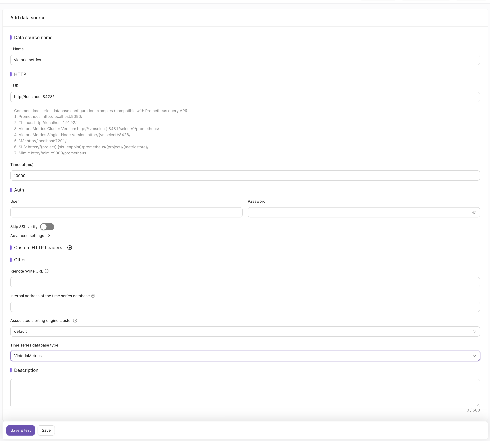

VictoriaMetrics integrates with [Nightingale](https://n9e.io/) (n9e), an open-source monitoring and alerting platform,
as a datasource for dashboards and alerting rules, and as remote storage for metrics received by Nightingale.

Resources:
* [Nightingale on GitHub](https://github.com/ccfos/nightingale)
* [VictoriaMetrics datasource docs in Nightingale](https://n9e.io/docs/data/victoriametrics)

## Datasource

Nightingale has no dedicated VictoriaMetrics datasource type. Use the `Prometheus` type,
since VictoriaMetrics supports [Prometheus querying API](https://docs.victoriametrics.com/victoriametrics/single-server-victoriametrics/#prometheus-querying-api-usage):

1. Go to `Integrations` → `Data sources` → `Add` and select `Prometheus`.
1. Fill the `URL` field:
   * single-node VictoriaMetrics: `http://<victoriametrics-addr>:8428/`
   * cluster VictoriaMetrics: `http://<vmselect-addr>:8481/select/<tenant>/prometheus/`
1. Set `Time series database type` to `VictoriaMetrics`. This makes Nightingale use
   VictoriaMetrics-specific endpoints for dashboard variables and for deleting series.
1. Click `Save & test`.



The configured datasource can be used in Nightingale dashboards, alerting rules and recording rules
with [MetricsQL](https://docs.victoriametrics.com/victoriametrics/metricsql/) expressions.

## Remote write

Nightingale can receive metrics from agents such as [Categraf](https://github.com/flashcatcloud/categraf)
and forward them to VictoriaMetrics via the [Prometheus remote write protocol](https://docs.victoriametrics.com/victoriametrics/integrations/prometheus/).
Configure the writer in Nightingale's `config.toml`:

```toml
[[Pushgw.Writers]]
# single-node VictoriaMetrics
Url = "http://<victoriametrics-addr>:8428/api/v1/write"
# cluster VictoriaMetrics
# Url = "http://<vminsert-addr>:8480/insert/<tenant>/prometheus/api/v1/write"
```

Note that the datasource `URL` points to vmselect, while `Pushgw.Writers` points to vminsert.
See [multitenancy](https://docs.victoriametrics.com/victoriametrics/cluster-victoriametrics/#multitenancy) for the meaning of `<tenant>`.

To store results of Nightingale recording rules in VictoriaMetrics, set `Remote Write URL` in the datasource form
to the same write endpoint as above.

For VictoriaLogs with Nightingale integration, check [this page](https://docs.victoriametrics.com/victorialogs/integrations/nightingale/).
